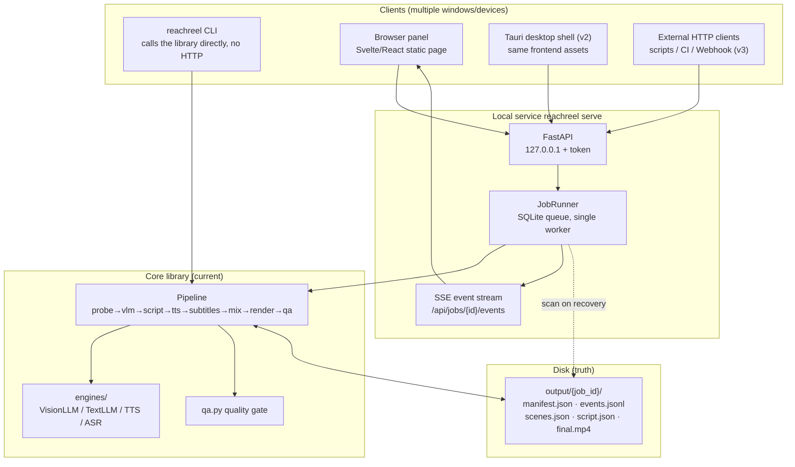
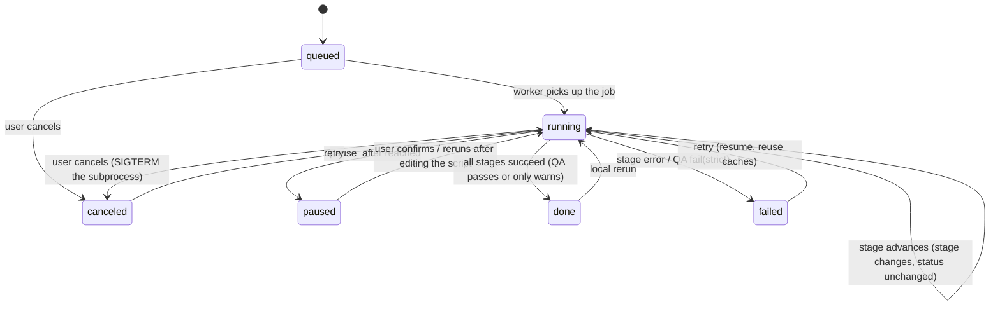

**English** | [简体中文](../zh-CN/DESKTOP_ARCHITECTURE.md)

# Desktop and Multi-Frontend Architecture

This document defines the architecture, contracts, and implementation order for ReachReel's move from a command-line tool to a "desktop panel + CLI dual entry points".

The conclusion first: **the panel is not a native GUI. Instead, ReachReel becomes a local service (`reachreel serve`), and the panel is its first client.**
The CLI, browser panel, future Tauri desktop shell, and an iPad on the LAN all go through the same contract.

Related docs: [Development](DEVELOPMENT.md), [Roadmap](ROADMAP.md), [Configuration](CONFIGURATION.md).

---

## 1. Product positioning

### 1.1 End state

ReachReel's center of gravity is already clear in the code: `workdir + manifest.json + cache reuse + stage commands + QA gate`.
These point to a product shape that is a **pipeline/factory**, not an editing suite.

| Direction | Will we go there | Rationale |
|---|---|---|
| Timeline editor for narrated videos | ❌ | Head-on competition with CapCut/Descript; UI investment is a bottomless pit |
| **Local batch narration factory** | ✅ | Unattended, resumable, quality gates, privacy never leaves the machine |
| Cloud SaaS | ❌ | Its only advantage is "footage never leaves the machine"; going cloud destroys itself |
| Local node + remote interface | ✅ (v3) | Keeps local compute and privacy while gaining multi-device/multi-user |

**The core interaction is just one thing: review the script → rerun locally.**

VLM analysis of 18 shots takes 20 minutes; changing one line of narration takes 40 seconds (reusing `scenes.json` and `vlm_cache.json`).
The value of the UI is turning "change one sentence → rerun only `tts → subtitles → mix → render → qa`" into a single click, not a big "Start" button.

### 1.2 Why a local service is mandatory

In one sentence: **the machine that computes and the machine that watches do not need to be the same.**

A single job takes 10–40 minutes, 20–32 GB of RAM, Apple Silicon + MLX. The end state inevitably looks like this:

```text
Mac mini (always-on render node, plugged in and left running)
   ↑ LAN
   iPad / laptop browser (review the script on the couch, change a sentence, click rerun)
```

A native GUI welds "interface" and "compute" to the same machine, the same process, and the same session, and can never reach this shape.

| Scenario | Native GUI | Local service + Web |
|---|---|---|
| Rendering for 30 minutes | Window cannot be closed; closing the lid kills it | Closing the page has no effect; the server keeps running |
| Switching devices / a second reviewer | Not possible | Just open a browser |
| Multi-platform clients | Write N UIs | One frontend |
| Adding a Tauri shell later | — | Frontend assets are reused directly |
| Automation (CI / watched folder / scheduled) | Build separately | Comes free with an HTTP API |

The only benefits of a native GUI (system integration, drag-and-drop, notifications, menu bar) can all be added in v2 with a Tauri shell, without touching the frontend.

---

## 2. Design principles

1. **The server is the only entry point.** The CLI and the panel share the same `Pipeline` / `JobRunner` call layer; do not write two sets of logic.
2. **Disk is the truth.** Job state comes from `manifest.json` and `events.jsonl`, not from in-memory objects. After a process restart, scan `output/` to rebuild the job list.
3. **Single-worker serial queue.** MLX/Ollama saturate memory; job-level concurrency only leads to OOM. Concurrency happens only inside a job (`vlm_workers`).
4. **Local-first, pluggable engines.** MLX is "one of the acceleration backends on arm64", not the only implementation; remote models are an optional fallback, not the main path.
5. **The privacy boundary stays near the footage; the interaction boundary stays away from the machine.** Visual frames stay on the local machine; only text summaries/narration may go remote.
6. **Stage-level actions must correspond one-to-one.** `reachreel tts <workdir>` ≡ `POST /api/jobs/{id}/stages {"stages":["tts"]}`.

---

## 3. Overall architecture



**Key point**: the CLI does not go through HTTP (offline use, scripts, and CI must all work), but it calls the same `Pipeline` as `JobRunner`.
The only difference between the two is "who owns the queue" — the CLI is its own queue.

### 3.1 Process model

```text
reachreel serve            # a single uvicorn process; binds 127.0.0.1 only by default
  └── worker thread/coroutine
        └── subprocess: python -m reachreel __run_job <job_id>
              └── Pipeline (MLX / Ollama / FFmpeg)
```

**Long-running work must run in a subprocess.** Reasons:

- MLX/Ollama may spike memory or crash outright, and must not take down the UI service;
- "Cancel" = `SIGTERM` to the subprocess tree, clean and simple;
- the subprocess's standard output is the event source: naturally structured, naturally reconnectable.

### 3.2 Directory model

```text
output/
  20251122_1430_snow_ski/      <- job_id (= workdir name, already generated in Pipeline)
    manifest.json              the truth about everything for "this job"
    events.jsonl               append-only event log (SSE can replay it)
    scenes.json  vlm_cache.json
    script.json  timeline.json
    tts/*.wav    narration.wav
    subtitles.srt  subtitles.ass
    bgm_loop.wav  mix.wav
    final.mp4    qa.json    review.md
```

`job_id` directly reuses the existing `Pipeline.__init__` rule `f"{video.stem}_{stamp}"`, **without introducing a second ID scheme**.

---

## 4. Job model

### 4.1 Fields

```python
@dataclass
class Job:
    id: str                 # == workdir name
    workdir: Path
    video_path: Path
    title: str              # defaults to video.stem, editable
    status: str             # queued|running|paused|done|failed|canceled
    stage: str | None       # current stage (one entry in STAGE_ORDER)
    stages: list[str]       # stages planned for this run (from --only / review rerun)
    params: dict            # snapshot of request parameters (brief/style/voice/height/burn...)
    pause_after: list[str]  # e.g. ["script"]: pause after that stage and wait for human review
    created_at / started_at / finished_at
    exit_code: int | None
    error: str | None       # failure reason (plain language, not a traceback)
    qa_status: str | None   # pass|warn|fail
    output_path: Path | None
    elapsed_seconds: float
```

### 4.2 State machine



**Recovery rules (important)**: on service startup run

```text
For each workdir under output/*/:
  has manifest.json + has events.jsonl end marker -> derive done/failed from manifest
  has manifest.json but no end marker              -> mark interrupted, attach a "can continue" action
  no manifest.json (only intermediate artifacts)   -> mark queued (can continue from cache)
```

Do not decide based on "is this job in memory"; depend only on disk.

### 4.3 Stages and artifacts (following the existing definitions)

| Stage | Label | Artifact | Can be rerun alone |
|---|---|---|---|
| `probe` | Read video | `scenes.json` | ✅ |
| `vlm` | Scene detection + visual analysis | `vlm_cache.json` | ✅ |
| `script` | Write narration | `script.json` | ✅ |
| `tts` | Voiceover + timeline | `timeline.json`, `narration.wav` | ✅ |
| `subtitles` | Subtitles | `subtitles.srt`, `.ass` | ✅ |
| `mix` | Mix | `mix.wav` | ✅ |
| `render` | Render final cut | `final.mp4` | ✅ |
| `qa` | Quality check | `qa.json` | ✅ |

Aliases continue to use `STAGE_ALIASES` (`analyze→vlm`, `timeline→tts`, `subtitle→subtitles`, `scenes→probe`).

---

## 5. Event protocol

### 5.1 Transport

- On disk: `{workdir}/events.jsonl`, one JSON object per line, append-only, `seq` monotonically increasing.
- Push: `GET /api/jobs/{id}/events?since=<seq>`, `text/event-stream`; first replay history with `seq > since`, then push live.
- A client that reconnects only needs to pass `since`; **no logs are lost and the progress bar is not re-rendered**.

### 5.2 Event types

```jsonc
// Job starts
{"seq":1,"t":1732269000.1,"type":"job_start","job":"20251122_1430_snow_ski","stages":["probe","vlm","script","tts","subtitles","mix","render","qa"]}

// Stage start/end
{"seq":2,"t":...,"type":"stage_start","stage":"vlm","label":"Scene detection + VLM visual analysis","total":18,"reused":0}
{"seq":9,"t":...,"type":"stage_end","stage":"vlm","ok":true,"elapsed":812.3,"reused":0}

// Progress (optional, within a stage)
{"seq":5,"t":...,"type":"progress","stage":"vlm","done":7,"total":18,"unit":"scenes"}
{"seq":6,"t":...,"type":"progress","stage":"render","done":0.42,"total":1.0,"unit":"segments"}

// Log (turn existing LOG.info calls into events while still writing to stderr)
// The contract is code + params; msg is the fallback rendering in the current process language (see LOCALIZATION.md §3.4)
{"seq":7,"t":...,"type":"log","level":"warning","stage":"mix","code":"bgm_not_found","params":{"dir":"inputs/bgm/"},"msg":"No BGM found in inputs/bgm/"}

// Artifact ready (the panel refreshes previews/buttons based on this)
{"seq":8,"t":...,"type":"artifact","stage":"script","name":"script.json","path":"...","meta":{"segments":12,"chars":418}}

// QA verdict
{"seq":20,"t":...,"type":"qa","status":"warn","warn":2,"fail":0,"items":[{"kind":"subtitle_overflow","at":37.2,"msg":"Subtitle overflow 12px"}]}

// Paused (waiting for human review)
{"seq":15,"t":...,"type":"paused","stage":"script","reason":"pause_after"}

// End
{"seq":21,"t":...,"type":"job_end","status":"done","output":"output/xxx/final.mp4","qa_status":"warn","elapsed":1934.5}
{"seq":21,"t":...,"type":"job_end","status":"failed","exit_code":1,"error":{"code":"llm_unreachable","params":{"url":"http://localhost:11434"},"message":"Cannot reach Ollama","hint":"Run `ollama serve`"}}
```

### 5.3 Implementation (minimal change)

`util.setup_logging()` gains a `sink` parameter:

```python
def setup_logging(verbose: bool = False, sink: Callable[[dict], None] | None = None) -> None: ...
```

`pipeline._run_stages` emits `stage_start/stage_end` at stage boundaries; each stage emits `progress` at "each completed unit" (VLM per scene, TTS per segment, render per second).
**Do not change business logic, only add instrumentation**; when no `sink` is passed, behavior is exactly the same as today.

The `render` stage needs real FFmpeg progress: pass `-nostats -progress pipe:1` and parse `out_time_ms` (two extra arguments + one callback on the existing command in `render.py`).

---

## 6. HTTP API contract

All endpoints require `X-ReachReel-Token` (see §10). By default it listens only on `127.0.0.1`.

| Method | Path | Corresponding CLI | Notes |
|---|---|---|---|
| GET | `/api/health` | — | Version, platform, whether busy, queue length (no token, local only) |
| GET | `/api/doctor` | `doctor --json` | Engine/dependency/model availability matrix; the panel renders it as a checklist |
| GET | `/api/engines` | — | Registered engines and `available` (unavailable entries grayed out) |
| POST | `/api/jobs` | `run` | Create a job and enqueue it. body: `{video, brief, preset, settings, only, pause_after}` |
| GET | `/api/jobs` | — | List, supports `?status=&limit=` |
| GET | `/api/jobs/{id}` | — | Details: manifest summary + stage status + QA |
| GET | `/api/jobs/{id}/events` | `run --emit-events` | SSE, supports `?since=` |
| POST | `/api/jobs/{id}/cancel` | — | `SIGTERM` the subprocess tree |
| POST | `/api/jobs/{id}/retry` | `run --workdir` | Continue from cache, keeping known stages |
| POST | `/api/jobs/{id}/stages` | `script/tts/subtitle/mix/render/qa` | `{stages:[...], force:false}`, **the only entry point for local reruns** |
| GET/PUT | `/api/jobs/{id}/script` | Edit `script.json` by hand | Review page read/write; after PUT it is recommended to automatically trigger `tts→…→qa` |
| GET | `/api/jobs/{id}/preview/{name}` | — | Allowlisted file playback: `final.mp4`, `narration.wav`, `tts/seg_007.wav` |
| POST | `/api/jobs/{id}/reveal` | — | Show in Finder/Explorer (`open -R` / `explorer /select,` / `xdg-open`) |
| GET/PUT | `/api/settings` | `config.toml` | Panel settings; secrets go through the Keychain separately and are never echoed in plaintext |

**Conventions**:
- Any write operation returns `{job, events_url}`; the frontend subscribes based on that and does not perform optimistic updates.
- Errors are uniformly `{"error": {"code": "...", "params": {...}, "message": "rendered in the current language", "hint": "what to do next"}}`; `code` is a localized contract and the panel translates it itself.
- Language: server output and client display language are decoupled, see [LOCALIZATION.md](LOCALIZATION.md).
- `settings` in `/api/jobs` is an **override**, synonymous with CLI options (reuse the field table in `cli._overrides` to avoid two sets of parameter names).

---

## 7. Local rerun (review loop)

This is the product's core loop, and its implementation relies entirely on existing capabilities:

```text
User edits the narration of segment 7 on the review page
  → PUT /api/jobs/{id}/script
  → POST /api/jobs/{id}/stages {"stages":["tts","render","qa"]}
      (the server fills in dependencies automatically: after tts it must run subtitles and mix before render)
  → SSE pushes stage_start(tts) ... artifact(final.mp4) ... qa
  → the panel refreshes only segment 7's timing and audio preview, not the whole page
```

**Dependency completion rules** (the server does this; don't expect users to understand it):

| User request | Actually executed |
|---|---|
| `script` | `script` (does not touch downstream; let the user read the draft first) |
| `tts` | `tts → subtitles → mix → render` (+qa) |
| `subtitles` | `subtitles → mix? (no) → render` |
| `render` | `render` (+qa) |
| any + `force=false` | reuse existing caches, redo only the affected segments |

TTS already synthesizes incrementally by text (`tts/*.wav` named by text hash), so when "only one sentence changes" only that segment is re-inferred.

---

## 8. Engine abstraction (cross-platform + remote)

### 8.1 Current state and goal

Currently `mlx-audio` / `mlx-whisper` are Apple Silicon exclusive. But the code boundaries are already good:

- `vlm.py` uses `POST {base_url}/v1/chat/completions` + Bearer → **already an OpenAI-compatible protocol**; changing `base_url`/`api_key` is enough to call a remote service.
- `tts.py:67` and `subtitles.py:297` both use **lazy imports inside functions**, so they are naturally replaceable.
- `misaki[zh]` (Chinese G2P) is pure Python and cross-platform → replacing TTS only requires replacing the vocoder inference backend.

### 8.2 Four interfaces

```python
# src/reachreel/engines/base.py
class VisionLLM(Protocol):
    name: str; location: Literal["local", "remote"]; available: bool
    def describe(self, images: list[Path], prompt: str) -> str: ...

class TextLLM(Protocol):
    name: str; location: Literal["local", "remote"]; available: bool
    def chat(self, messages: list[dict], **kw) -> str: ...

class TTS(Protocol):
    name: str; location: Literal["local", "remote"]; available: bool
    def synthesize(self, text: str, voice: str, speed: float) -> tuple[bytes, int]: ...  # (PCM, sample_rate)

class ASR(Protocol):
    name: str; location: Literal["local", "remote"]; available: bool
    def spans(self, wav: Path, language: str) -> list[Span]: ...   # speech boundaries only
```

### 8.3 Engine matrix

| Capability | macOS arm64 | Windows / Linux | Remote |
|---|---|---|---|
| VLM | Ollama `qwen3-vl` (current) | Ollama / LM Studio / llama.cpp | Any OpenAI-compatible (Qwen-VL, Gemini, OpenAI) |
| LLM | Ollama `qwen3` (current) | Same as above | Any OpenAI-compatible |
| TTS | `kokoro-mlx` (current) | `kokoro-onnx` (runs on CPU, G2P reuses misaki) | OpenAI `tts-1`, DashScope CosyVoice, MiniMax |
| ASR | `mlx-whisper` (current) | `faster-whisper` (CTranslate2 int8, CPU is enough) | OpenAI Whisper, Groq |
| `say` | macOS only (kept as a fallback) | — | — |

**Recommended fallback combinations** (the panel exposes only two switches; don't make users configure 4 backends):

```text
Default "fully local"   VLM local · LLM local · TTS local · ASR local
"Light remote"          VLM local (frames never leave the machine) · LLM remote · TTS local/remote · ASR local
```

> Moving only the "write the script" step to remote is the best trade-off between privacy and compute: only scene summary text is uploaded, not frames.

### 8.4 Configuration groups

```toml
[vlm]
provider = "ollama"          # ollama | openai
base_url = "http://localhost:11434"
model    = "qwen3-vl:8b-instruct"
api_key_env = "REACHREEL_VLM_KEY"

[llm]
provider = "openai"
base_url = "https://dashscope.aliyuncs.com/compatible-mode"
model    = "qwen3-max"
api_key_env = "DASHSCOPE_API_KEY"

[tts]
provider = "kokoro-mlx"      # kokoro-mlx | kokoro-onnx | openai | say
voice    = "zf_xiaoxiao"

[asr]
provider = "mlx-whisper"     # mlx-whisper | faster-whisper | openai
model    = "mlx-community/whisper-large-v3-turbo"
```

Backward compatibility: the old flat keys (`ollama_url`, `vlm_model`, `llm_model`, `tts_engine`, `whisper_model`) remain valid; on load they are mapped to the new groups with unchanged precedence (defaults < toml < environment variables < CLI).

**Secrets do not go into toml**: macOS Keychain (`security add-generic-password`), Windows DPAPI, Linux `secret-tool`; the fallback is the environment variable pointed to by `api_key_env`. The panel uses masked input.

### 8.5 Cache keys must include provider

The current key in `vlm.py`:

```python
settings_key = f"{model}|{PROMPT_VERSION}|{max_width}|{context}"
```

Local `qwen3` and remote `qwen3-max` would collide in the cache. Change to:

```python
settings_key = f"{provider}|{base_url_host}|{model}|{PROMPT_VERSION}|{max_width}|{context}"
```

The text hash keys for TTS/ASR work the same way: add `provider` and `voice`/`model`.

### 8.6 doctor output

```bash
reachreel doctor --json
```

```json
{"platform":{"os":"macos","arch":"arm64","py":"3.12.7"},
 "engines":{
   "vlm":{"provider":"ollama","location":"local","ok":true,"detail":"qwen3-vl:8b-instruct ready"},
   "llm":{"provider":"ollama","location":"local","ok":true,"detail":"..."},
   "tts":{"provider":"kokoro-mlx","location":"local","ok":true,"detail":"..."},
   "asr":{"provider":"mlx-whisper","location":"local","ok":true,"detail":"..."}},
 "deps":{"ffmpeg":{"ok":true,"path":"/opt/homebrew/opt/ffmpeg-full/bin/ffmpeg","libass":true},
         "fonts":{"ok":true,"path":".../NotoSansSC-Subset.otf"}},
 "notes":["16 GB RAM: set vlm_workers = 1"]}
```

---

## 9. Required cross-platform fixes (P0, before the panel)

These 6 items must be fixed before the panel; otherwise Windows/Linux cannot even run the pipeline.

| # | Location | Problem | Fix |
|---|---|---|---|
| 1 | `util.py:42` | `subprocess.run(text=True)` decodes with the system encoding; on Windows, FFmpeg output containing Chinese paths raises `UnicodeDecodeError` | add `encoding="utf-8", errors="replace"` |
| 2 | `config.py:53` | `subtitle_font = "PingFang SC"` is macOS-only; when missing, libass falls back silently → glyph widths change → false QA "subtitle overflow" reports | ship a subsetted Source Han Sans/Noto Sans SC with the app, add `fontsdir=` to the `subtitles` filter, fix `FontName` |
| 3 | `pyproject.toml` | MLX dependencies fail outright when installing on Windows/x86 | split extras: `accel-mlx` / `cpu` / `gui`; keep `misaki[zh]` in the main dependencies |
| 4 | dependency tree | `torch` is installed at 580 MB but imported nowhere in the code; the Windows CUDA build is even worse | strip at build time, or install precisely with `--no-deps` |
| 5 | global | paths depend on CWD (`output/`, `inputs/bgm/`), which inevitably fails inside `.app`/`.exe` | `platformdirs`: `~/Library/Application Support/ReachReel`, `%APPDATA%\ReachReel`, `~/.local/share/reachreel` |
| 6 | `util.py:94` | FFmpeg detection hardcodes the Homebrew path | add "app-bundled `<resources>/bin/ffmpeg`" and prefer it; Windows uses the BtbN GPL static build, Linux uses johnvansickle static |

Other platform details: Windows long paths (workdir uses a short ID, don't expand Chinese names), `vlm_workers` default per platform (Windows reclaims VRAM slowly, default 1), `say` engine marked macOS-only.

---

## 10. Security model

The panel is a local tool, not a public service. Hard constraints:

1. **Bind to `127.0.0.1` by default**, with a random port or starting at 8760.
2. **Generate a one-time token at startup**, write it to `~/.reachreel/token` (permissions 0600); the frontend is injected via the URL fragment by `serve --open`; every `/api/*` validates `X-ReachReel-Token` (except `/api/health`).
3. **No CORS**; static assets and API are same-origin; validate `Origin`/`Host` headers and reject cross-site requests (`Sec-Fetch-Site` check).
4. **File endpoint allowlist**: `/preview/{name}` only permits `final.mp4`, `narration.wav`, `mix.wav`, `subtitles.srt`, `tts/*.wav`; arbitrary path concatenation is forbidden.
5. **Remote access requires explicit opt-in**: `serve --host 0.0.0.0 --password ...`, with a prominent notice on the settings page that "this is not a public service". Document clearly that port forwarding must not be set up.
6. `video` in `POST /api/jobs` accepts only paths that exist on the local machine; uploads go to a separate temporary directory and are never written into `output/`.

---

## 11. Packaging and distribution

| Layer | Choice |
|---|---|
| Shell | **Tauri** (v2): one frontend, artifacts `.dmg` / NSIS `.exe` / `.AppImage`; the shell is 10–20 MB |
| Python | python-build-standalone, dependencies installed into the interpreter's own `site-packages` (**do not ship a venv**; venvs contain absolute paths) |
| Dependencies | per-platform extras: MLX on mac, onnx + faster-whisper on Win/Linux |
| FFmpeg | bundled (libass required on all three platforms), `FFMPEG_FULL` points to `<resources>/bin/ffmpeg` |
| Fonts | bundled subsetted Chinese font (OFL) to guarantee consistent subtitle rendering on all three platforms |
| Updates | Tauri updater; models and Ollama are not in the installer and are downloaded on first run |

Size targets (after removing torch): macOS arm64 **450–600 MB**, Windows x64 **550–700 MB**, Linux x64 **550–700 MB**.
Do not bundle CUDA; GPU users install `onnxruntime-gpu` themselves.

Signing: macOS uses Developer ID + `notarytool` (requires the `com.apple.security.cs.allow-jit` and `com.apple.security.cs.disable-library-validation` entitlements); Windows uses Authenticode or Azure Trusted Signing; Linux publishes AppImage + checksum.
**No App Store** (GPL FFmpeg, external Ollama, runtime model downloads).

---

## 12. v1 scope

### Do

| Page | Contents |
|---|---|
| New | Drag a video / paste a path / watch `inbox/`; `brief`, presets (travel/city/product/vertical), `dry-run` preview of which stages will run and what will be reused |
| Queue | Card list: thumbnail, duration, status, stage progress, ETA, disk usage; sort, pause, cancel, retry |
| Detail | Stage timeline (done/reused/rerun), live logs, QA report (red/yellow/green, click to jump to the corresponding timestamp) |
| Review | Segment-by-segment narration editing, per-segment audio preview, per-segment rerun (→ `tts→render→qa`), subtitle line preview |

Tech stack: backend FastAPI + SQLite + SSE; frontend Svelte or React + Vite + Tailwind, pure static hosting (no Next.js/SSR).
Estimate: backend 800–1200 lines, frontend 1500–2500 lines, **about 2 weeks** (events and stage commands already exist; the work is "moving and displaying").

### Don't

Timeline editing, multi-track audio, transition effects, media cloud drive, account systems, App Store, Windows GPU, multi-machine distribution, Gradio/Streamlit-style single-page forms.

**Do not use Gradio/Streamlit**: fast to start, but it locks you into a "single-page form" and makes the review loop, queue, and reconnect impossible.

---

## 13. Evolution path

```text
v1 (~2 weeks)   Local web panel: single machine, single queue, 4 pages, review loop; CLI unchanged
                Acceptance: two real clips run end-to-end to a final cut in the browser, and changing one sentence reruns in 40 seconds

v2 (~1 month)   Tauri shell (same frontend: double-click to use, drag-and-drop, notifications, menu bar always available)
                + preset templates + batch (drop a folder = N jobs) + graphical engine matrix
                + P0 cross-platform fixes complete, Windows/Linux can produce a final cut

v3 (~3 months)  Render node mode: always-on Mac mini, LAN multi-user access;
                project manager reviews + editors receive only the final cut; external HTTP API / Webhook
```

v3 is not "going cloud" but "local node + remote interface": compute and footage stay on the local machine, and interaction extends to any device.

---

## 14. Open decisions

| Item | Recommendation | Status |
|---|---|---|
| Whether Windows GPU (CUDA) goes into the first release | No; CPU + remote first | Pending |
| Which provider to document as the remote default | Only write "any OpenAI-compatible + custom base_url"; do not bind to a vendor | Pending |
| Whether panel features are 100% aligned with the CLI | Aligned (same JSONL protocol) | Proposed to approve |
| Definition of cross-platform | Design for "consistent experience on three platforms", accept "Win/Linux can produce a final cut" | Proposed to approve |
| Whether v1 should first hand-write a minimal HTML page to validate the event stream | Yes; at most two days wasted, avoiding two weeks of rework | Proposed to approve |

---

## 15. Implementation order

**P0 · Correctness (no architecture change, ~1 week)**
1. `util.run` encoding
2. `platformdirs` paths
3. split extras, remove `torch`
4. bundled subsetted fonts + `fontsdir`
5. FFmpeg detection prefers the bundled binary
6. `doctor --json`
7. tests: non-ASCII filenames, vertical video, paths with spaces

**P1 · Service-ification (~2 weeks)**
8. `src/reachreel/events.py`: `EventSink` + `events.jsonl` + `pipeline._run_stages` instrumentation
9. `src/reachreel/jobs.py`: SQLite job table, single-worker queue, startup scan recovery
10. `src/reachreel/server/app.py`: REST + SSE + token
11. `src/reachreel/cli/main.py` add `serve`, `run --emit-events`
12. frontend four pages (first validate with a hand-written 200-line HTML page, then move to a framework)

**P2 · Engines and remote (~2 weeks)**
13. `engines/` four interfaces + registry (move MLX over as the default)
14. remote provider + secret storage + cache key includes provider
15. `faster-whisper` ASR (biggest payoff: immediate Win/Linux support)
16. `kokoro-onnx` TTS

**P3 · Packaging (~1 week)**
17. Tauri shell, three-platform build scripts, signing and notarization, update channel

---

## 16. v1 acceptance criteria

- [ ] `reachreel serve --open` opens the panel with one command; existing `output/` jobs are visible in the browser
- [ ] Create a job in the browser → run to completion → queue status, ETA, logs, and QA are all visible
- [ ] Close the browser for 10 minutes and reopen it; progress and logs are not lost (SSE replay)
- [ ] `Ctrl-C` / cancel → the subprocess is cleaned up, leaving no orphaned FFmpeg/Ollama requests
- [ ] Edit one narration segment on the review page → only `tts→render→qa` rerun, taking < 1 minute
- [ ] After a service restart, `interrupted` jobs can be continued with one click (reusing caches)
- [ ] All CLI command behavior is exactly the same as today (no GUI dependency, no HTTP dependency)
- [ ] The panel shows a "local/remote · model name" badge for every stage
- [ ] When Ollama is not installed / a model is missing / FFmpeg is missing, the panel gives clickable remediation guidance instead of a stack trace
