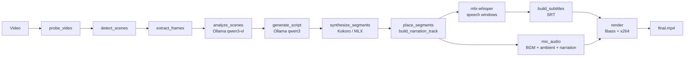

**English** | [简体中文](../zh-CN/DEVELOPMENT.md)

# Development

This document is for people who want to change code, add features, or troubleshoot problems. For usage, see [USER_GUIDE.md](USER_GUIDE.md); for configuration, see [CONFIGURATION.md](CONFIGURATION.md).

---

## 1. Design goals

ReachReel is not "yet another do-everything video editor" but a **readable, modifiable, recoverable** local pipeline:

- every stage has explicit input/output files;
- intermediate artifacts are reusable, and editing the script only reruns the affected stages;
- fully local by default, with no cloud API;
- first make "watch the footage → write the script → voiceover → subtitles → mix → final cut" work end to end, then add capabilities incrementally;
- keep the codebase within a maintainable size, and do not pile on frameworks for features.

---

## 2. Overall architecture



Entry point: `src/reachreel/cli/main.py`. Orchestration: the `Pipeline` class in `src/reachreel/pipeline/orchestrator.py`.

### Stage order

```text
prepare_scenes
  ├─ probe_video
  ├─ detect_scenes
  └─ extract_frames
understand
  └─ analyze_scenes
write_script
  ├─ generate_script
  └─ write_script_md (review gate)
make_voice
  └─ synthesize_segments
make_timeline
  ├─ place_segments
  └─ build_narration_track
make_subtitles
  └─ build_subtitles
make_mix
  ├─ pick_bgm
  ├─ prepare_bgm_loop
  └─ mix_audio
render_final
  └─ render
write_manifest
write_review
qa
  └─ run_qa
```

---

## 3. Module map

| File | Responsibility | Key functions/classes |
|---|---|---|
| `src/reachreel/cli/main.py` | Argument parsing, subcommands | `main`, `build_parser` |
| `src/reachreel/core/config.py` | Config dataclasses, TOML, environment variables, precedence | `Settings`, `Settings.load` |
| `src/reachreel/core/util.py` | Subprocesses, ffprobe, JSON, timestamps | `run`, `ffprobe_json`, `ffmpeg_full`, `srt_timestamp` |
| `src/reachreel/core/cache.py` | Shared cache paths, video fingerprint, cleanup | `cache_root`, `video_key`, `cache_stats`, `clean_cache` |
| `src/reachreel/i18n/__init__.py` | CLI/UI language negotiation and message catalog | `t`, `set_language`, `negotiate_language` |
| `src/reachreel/prompts/__init__.py` | Prompt-pack and content-catalog loader | `load_prompt`, `load_content`, `text` |
| `src/reachreel/prompts/{zh,en}/` | Language-specific prompts and fallback data | `vlm.txt`, `script.txt`, `style.txt`, `messages.toml` |
| `src/reachreel/domain/models.py` | Shared domain models | `VideoInfo`, `Scene`, `NarrationSegment`, `Cue`, `QualityFlag` |
| `src/reachreel/domain/timeline.py` | Narration placement, global speed-up, narration track | `place_segments`, `build_narration_track` |
| `src/reachreel/engines/vlm.py` | Ollama OpenAI-compatible client, VLM prompt, cache | `OllamaClient`, `analyze_scenes` |
| `src/reachreel/engines/tts.py` | Kokoro / say synthesis, text chunking, cache | `KokoroEngine`, `SayEngine`, `synthesize_segments` |
| `src/reachreel/generation/script.py` | Script writing, compression/expansion, fallback | `generate_script` |
| `src/reachreel/media/scenes.py` | Video probing, scene detection, frame extraction | `probe_video`, `detect_scenes`, `extract_frames` |
| `src/reachreel/media/subtitles.py` | Whisper transcription, speech windows, SRT, ASS layout | `cues_from_timeline`, `build_subtitles`, `write_ass` |
| `src/reachreel/media/audio.py` | BGM selection/looping, catalog metadata, license export, sidechain ducking, loudness | `pick_bgm`, `mix_audio`, `bgm_metadata`, `bgm_license_markdown` |
| `src/reachreel/media/render.py` | Scaling/frame rate, burned-in/soft subtitles, muxing | `render`, `subtitle_style` |
| `src/reachreel/pipeline/orchestrator.py` | Stage orchestration, caching, manifest, doctor | `Pipeline`, `doctor`, `doctor_report` |
| `src/reachreel/pipeline/qa.py` | Final-cut quality gate | `run_qa`, `print_report`, `parse_srt` |
| `scripts/check_commit_messages.py` | Conventional Commits validator shared by the git hook and CI | `validate`, `messages_in_range` |
| `scripts/check_changelog.py` | `CHANGELOG.md` / `CHANGELOG.zh-CN.md` structural parity | `parse`, `compare`, `main` |

---

## 4. Data formats

All intermediate files live under `workdir/` and use UTF-8 JSON.

### 4.1 `scenes.json`

```json
{
  "video": {
    "path": "/abs/path/video.mp4",
    "duration": 92.891667,
    "width": 3840,
    "height": 2160,
    "fps": 59.94,
    "has_audio": true,
    "audio_channels": 2,
    "audio_sample_rate": 44100,
    "rotation": 0.0,
    "coded_width": 3840,
    "coded_height": 2160
  },
  "scenes": [
    {
      "id": 1,
      "start": 0.0,
      "end": 7.74,
      "frames": ["/abs/workdir/frames/scene_0001_00.jpg"],
      "summary": "观光船靠近尼亚加拉瀑布，游客穿雨衣观景",
      "details": ["白色水雾", "绿色河水", "阴天"],
      "mood": "壮阔",
      "place": "尼亚加拉瀑布",
      "hint": "从水雾和船的行进角度写",
      "subjects": ["游客", "观光船"],
      "actions": ["乘船靠近瀑布"],
      "duration": 7.74
    }
  ]
}
```

- `width` / `height` are the **display resolution**: if the video carries 90°/270° rotation metadata, width and height are swapped.
- `coded_width` / `coded_height` are the encoded frame size before rotation is applied; `0` means an old work directory that predates these fields.
- `frames` are absolute paths.
- VLM fields may be empty; the script stage has a fallback.

### 4.2 `vlm_cache.json`

```json
{
  "settings": "zh|qwen3-vl:8b-instruct|vf-vlm-2|768|已知背景...",
  "scenes": {
    "1:0.000:7.740": {
      "summary": "...",
      "place": "...",
      "subjects": [],
      "actions": [],
      "details": [],
      "mood": "...",
      "narration_hint": "...",
      "raw": "..."
    }
  }
}
```

- The cache key includes the content language, model, prompt version, frame extraction width, and `brief`.
- Changing these settings invalidates the cache.
- `--force` deletes the cache file.

### 4.3 `script.json`

```json
{
  "content_language": "zh",
  "segments": [
    {
      "id": 1,
      "scene_ids": [1, 2, 3],
      "text": "水声越来越大，船正往瀑布腹地开。",
      "audio_path": "",
      "duration": 0.0,
      "start": 0.0,
      "end": 0.0,
      "tts_speed": 1.0
    }
  ]
}
```

- `text` is a human-editable field;
- `audio_path` / `duration` / `start` / `end` / `tts_speed` are filled in by later stages;
- `scene_ids` determines which scene the narration is anchored to.

### 4.4 `timeline.json`

```json
{
  "segments": [
    {
      "id": 1,
      "scene_ids": [1, 2, 3],
      "text": "...",
      "audio_path": "/abs/workdir/tts/seg_001_abcd1234.wav",
      "duration": 7.28,
      "start": 0.7,
      "end": 7.98,
      "tts_speed": 1.0
    }
  ],
  "total_chars": 203
}
```

### 4.5 `manifest.json`

Key fields:

```json
{
  "video": { "...": "same as scenes.json" },
  "workdir": "...",
  "output": "...",
  "settings": {
    "vlm_model": "...",
    "llm_model": "...",
    "tts_engine": "kokoro",
    "voice": "zf_xiaoxiao",
    "whisper_model": "...",
    "bgm": "...",
    "burned_subtitles": true
  },
  "render_settings": {
    "output_height": 1920,
    "output_fps": 30,
    "crf": 20,
    "subtitle_size": 56,
    "subtitle_render": "outline",
    "subtitle_outline": 0.0,
    "subtitle_box_padding": 0.0,
    "subtitle_size_unit": "px",
    "subtitle_layout": "ass",
    "subtitle_max_chars": 14,
    "subtitle_margin_v": 220,
    "burn_subtitles": true
  },
  "settings_snapshot": {
    "ollama_url": "http://localhost:11434",
    "vlm_model": "qwen3-vl:8b-instruct",
    "llm_model": "qwen3:30b-instruct",
    "voice": "zf_xiaoxiao",
    "tts_engine": "kokoro",
    "...": "full Settings snapshot for stage commands to restore from"
  },
  "bgm_source": "/abs/inputs/bgm/ski-ukulele.mp3",
  "bgm_metadata": {
    "file": "ski-ukulele.mp3",
    "title": "...",
    "author": "...",
    "source": "https://...",
    "license": "CC0-1.0"
  },
  "cache": {
    "enabled": true,
    "dir": "/Users/you/.cache/reachreel",
    "video_key": "5c1f..."
  },
  "quality_flags": [
    {
      "code": "asr.fallback",
      "params": {"engine": "mlx-whisper", "model": "..."},
      "severity": "warning"
    }
  ],
  "scenes": 12,
  "narration_segments": 5,
  "narration_chars": 146,
  "narration_seconds": 33.4,
  "timeline": [],
  "elapsed_seconds": 220.6,
  "qa": {
    "pass": 17,
    "warn": 0,
    "fail": 0,
    "status": "pass",
    "exit_code": 0
  }
}
```

`render_settings` lets `reachreel render` reproduce the previous output size, subtitle style, and CRF.

`quality_flags` records degradations that did not stop the run. Current codes:

| Code | Meaning |
|---|---|
| `vlm.scene_failed` | One scene failed after retries; its summary came from the fallback. |
| `vlm.no_frames` | No keyframe was available for a scene. |
| `vlm.unparsed` | The VLM returned text that was not valid JSON. |
| `tts.segment_failed` | One segment failed after retries and was skipped. |
| `asr.fallback` | Whisper was unavailable or failed; subtitle timing fell back to the TTS timeline. |
| `asr.empty` | Whisper returned no cues while `subtitle_text = "asr"`. |
| `qa.warn` / `qa.fail` | The QA gate reported warnings or failures. |

`bgm_metadata` is copied from `inputs/bgm/manifest.json` when the track exists in the catalog; `reachreel licenses <workdir>` renders it as `licenses.md`.

### 4.6 Other files

| File | Description |
|---|---|
| `frames/*.jpg` | Keyframe for each scene |
| `tts/seg_XXX_<hash>.wav` | Per-segment voiceover, 48k mono |
| `narration.wav` | Full-length narration track, including silence gaps |
| `bgm_loop.wav` | BGM looped to the video length |
| `mix.wav` | Final mix |
| `subtitles.srt` | Subtitles (soft-subtitle/compatible) |
| `subtitles.ass` | Burned-in subtitle layout, `PlayResX/Y` = output resolution |
| `script.md` | Human-readable script preview for the review gate |
| `qa.json` | QA gate results |
| `licenses.md` | BGM license list exported by `reachreel licenses` |
| `final.mp4` | Final cut |

### 4.7 Shared cache (optional)

The cross-workdir cache is separate from the work directory:

```text
~/Library/Caches/reachreel/   # platform cache dir; legacy ~/.cache/reachreel is reused
├── vlm/<video_key>.json   # VLM results keyed by a sampled video fingerprint
└── tts/<hash>.wav         # segment audio keyed by engine/model/voice/speed/text
```

The VLM file reuses the `vlm_cache.json` schema. `cache_dir` changes the root; `cache_enabled = false`, `REACHREEL_CACHE=0`, or `--no-cache` disables it. `reachreel cache info` and `cache clean --yes` inspect and remove it.

---

## 5. Key algorithms

### 5.1 Scene detection

`scenes.detect_scenes`:

1. Find hard cuts using FFmpeg's scene score:

   ```bash
   ffmpeg -i video -filter:v "select='gt(scene,0.32)',showinfo" -an -f null -
   ```

2. Parse `pts_time:` from stderr.
3. Add head and tail boundaries to get the raw intervals.
4. Split intervals longer than `max_scene_seconds`.
5. Try to merge intervals shorter than `min_scene_seconds` with the previous interval.
6. When there are more than `max_scenes`, merge evenly.
7. If there are no intervals at all, fall back to one full-length scene.

> PySceneDetect is not used today, and there is no in-scene motion clustering; both are possible future improvements.

### 5.2 Frame extraction

`extract_frames`:

- for each scene, sample `vlm_frames_per_scene` timestamps evenly within `[start+pad, end-pad]`;
- extract frames with `ffmpeg -ss T -i video -frames:v 1 -vf scale=...`;
- use `ThreadPoolExecutor` with concurrency 4;
- output `frames/scene_XXXX_YY.jpg`;
- then deduplicate: each frame is downscaled to a 16x16 grayscale thumbnail, and a frame is dropped (file deleted, path removed from `scenes.json`) when its mean absolute pixel difference from the last kept frame is below `vlm_frame_dedup` (default `4.0`, `0` disables). `select_representative_frames` is a pure helper, so the rule is unit-tested without FFmpeg;
- the threshold is part of the VLM cache key (`engines.vlm.settings_key`), because it changes which frames the model sees.

### 5.3 VLM analysis

`vlm.analyze_scenes`:

- uses Ollama's OpenAI-compatible endpoint `/v1/chat/completions`;
- sends 1–3 images per scene plus a Chinese JSON prompt;
- output fields: `summary` `place` `subjects` `actions` `details` `mood` `narration_hint`;
- `brief` is injected into the prompt as "known background";
- on parse failure, the raw text is kept so the run can mostly continue;
- cached by `scene_id:start:end`.

### 5.4 Script writing

`script.generate_script`:

1. Compute the target character count:

   ```text
   target_chars = duration × speech_chars_per_second × narration_density
   ```

2. Build a scene table and ask the LLM to output a JSON array:

   ```json
   [{"scene_ids": [1,2], "text": "..."}]
   ```

3. At least `min_segments = duration / 14` segments (at most 10);
4. If the total character count exceeds `1.22 × target` → request compression;
5. If the total character count is below `0.72 × target` and the duration is > 25s → request expansion;
6. If JSON parsing fails → generate a fallback script from the scene summaries.

> There is no strict fact checking; `brief` and the prompt constraints are the main defenses against hallucination.

### 5.5 TTS

`tts.synthesize_segments`:

- uses `mlx_audio` to load Kokoro;
- splits text at punctuation into chunks of ≤70 characters to avoid instability on long sentences;
- concatenates the chunks after synthesis, with 120ms of silence between chunks;
- 24k → 48k / mono / PCM S16;
- cache key = `engine|model|voice|speed|text`;
- the `say` engine is a macOS debug fallback.

### 5.6 Timeline

`timeline.place_segments`:

```text
anchor = start of the first scene in the segment
start  = max(anchor, cursor)
end    = start + duration
cursor = end + min_gap_seconds
```

If the last segment exceeds the video length:

```text
factor = (last_end - start_offset) / (duration - tail_padding - start_offset)
factor = clamp(factor, 1.0, max_speedup)
```

Apply `atempo=factor` to every segment and place them again.

`build_narration_track`:

- build a 48k silent track with numpy;
- overlay each segment wav at its `start`;
- 12ms fade in/out to avoid clicks;
- if the peak exceeds 0.98, attenuate the whole track.

### 5.7 Subtitles

`subtitles.build_subtitles`:

1. Transcribe `narration.wav` with `mlx-whisper` to get `segments` / `words`;
2. For each narration segment, find overlapping Whisper segments to get a more precise speech start/end window;
3. Split lines using the **original script text** by `subtitle_max_chars` and `subtitle_max_lines`: CJK prefers punctuation boundaries, whitespace languages pack whole words;
4. Distribute time within the speech window by character count plus a pause bonus after sentence/clause punctuation;
5. Generate SRT.

Key points:

**Style** (`subtitles.subtitle_border`, `subtitle_render`):

- `outline` (default): `BorderStyle=1`, white fill, black outline colour, stroke width `subtitle_outline` or about 6% of `subtitle_size`, plus a soft shadow. The stroke follows the glyph edges, so the footage behind the text stays visible;
- `box`: `BorderStyle=3`, the older translucent black box (`BackColour=&H80000000`) whose padding is `height / 288`, or `subtitle_box_padding` when set;
- `none`: `BorderStyle=1` with `Outline=0` and `Shadow=0` — plain white text, no stroke.

Because `PlayResX/Y` equals the output resolution and `ScaledBorderAndShadow: yes`, the stroke width is real pixels.

Other key points:

- ASR text is not used, avoiding homophone typos;
- no characters are dropped: `_cue_texts` guarantees every character lands in some cue;
- the line length and line count limits are hard constraints;
- `subtitle_preset` (`douyin` / `reels` / `shorts` / `landscape`) overrides the manual safe margins and applies to both ASS output and QA;
- timestamps are segment/line-level precision, not per-character karaoke.

### 5.8 Mixing

Filter graph of `audio.mix_audio`:

```text
[narration] aformat=48k/stereo, asplit=3 -> [nar][sc_amb][sc_bgm]

[original] volume=ambient_volume -> [amb]
[amb][sc_amb] sidechaincompress -> [amb_duck]

[bgm] volume=bgm_volume, afade=t=out -> [bgm]
[bgm][sc_bgm] sidechaincompress -> [bgm_duck]

[amb_duck][bgm_duck][nar] amix -> [premix]
[premix] loudnorm(measure) -> JSON            # first pass
[premix] loudnorm(measured, linear=true) -> alimiter -> [aout]  # second pass
```

- the `sidechaincompress` ratio is approximated from `abs(duck_db)/2`;
- when ambient audio or BGM is missing, `asplit` outputs are reduced automatically to avoid empty labels;
- BGM fades out over `bgm_fade_seconds` before ducking;
- `two_pass_loudnorm` measures the mix first, then applies a linear normalization; if measurement fails it falls back to single-pass;
- loudness is finally normalized to `target_lufs` with true peak `true_peak`.

### 5.9 Rendering

`render.render`:

- prefers `ffmpeg_full()` (with libass);
- filter chain: `scale` (optional) → `fps` (optional) → `subtitles`;
- burned-in subtitles use `force_style` to control font, size, border, and margins;
- soft-subtitle mode muxes the SRT as a `mov_text` track;
- H.264 + AAC + `+faststart`;
- uses `-t audio_duration` to control the duration, so the subtitle track cannot make `-shortest` cut the output short.

### 5.10 Stage commands

Stage entry points exposed by `Pipeline`:

| Method | Command | Input | Output |
|---|---|---|---|
| `stage_script` | `reachreel script` | `scenes.json` + VLM cache | `script.json` |
| `stage_tts` | `reachreel tts` | `script.json` | `tts/` + `timeline.json` + `narration.wav` |
| `stage_subtitle` | `reachreel subtitle` | `timeline.json` + `narration.wav` | `subtitles.srt` + `subtitles.ass` |
| `stage_mix` | `reachreel mix` | `narration.wav` + BGM | `mix.wav` |
| `render_final` | `reachreel render` | `mix.wav` + SRT/ASS | `final.mp4` |
| `run_qa` | `reachreel qa` | `final.mp4` + intermediate files | `qa.json` |

Stage commands restore parameters from `settings_snapshot` / `render_settings` in `manifest.json`; command-line arguments take precedence.

### 5.11 QA gate

`qa.run_qa` checks:

- output/stream/duration/audio-video sync;
- `loudnorm` integrated loudness and true peak;
- `astats` peak / full-scale samples / Flat factor clipping;
- `blackdetect`; `freezedetect` plus a comparison against source-footage motion (static long shots are not false-flagged);
- SRT cue count, layout, timing, overlaps, boundaries;
- subtitle pixel overflow: prefer rendering the `subtitles.ass` that burned-in subtitles actually use (older work directories fall back to SRT), take the bounding box with `bbox`, and compare it against the safe margins;
- the max `tts_speed`, end position, and per-sentence narration/subtitle alignment in `timeline.json`;
- BGM file, burned-in/soft subtitle mode.

Thresholds are centralized in `QAThresholds` and populated from the `qa_*` fields in `settings_snapshot` or the `[qa]` table; `qa.json` records the thresholds used for the run. Results are written to `qa.json`; in `strict` mode warnings also return non-zero.

---

## 6. Caching and resume

Local inputs live under `inputs/` and are ignored by Git: `inputs/bgm/` is used today; `inputs/fonts/` and `inputs/models/` are reserved. See [BGM](BGM.md).

| Cache | Location | Invalidation |
|---|---|---|
| Scenes/frames | `scenes.json` + `frames/` | `--force`, video path change, `--no-resume` |
| VLM | `vlm_cache.json` | `--force`, model/prompt/width/`brief` change |
| Narration | `script.json` | `--force`, `--no-resume`, manual deletion |
| TTS | `tts/seg_*_<hash>.wav` | text/voice/model/speed change, `--force` |
| Render | `final.mp4` | rerendered on every `run` |

`Pipeline` checks that the video path matches when reusing `scenes.json`; if it does not, it re-analyzes.

---

## 7. Extension points

> The engine abstraction for cross-platform and remote models (the four `engines/` interfaces plus the registry) is designed in [DESKTOP_ARCHITECTURE.md §8](DESKTOP_ARCHITECTURE.md).
> Sections 7.1 / 7.2 below are stopgaps in the current code; they will be consolidated into `engines/` after the migration.

### 7.1 Add a TTS engine

1. Implement a class in `tts.py`:

   ```python
   class MyTTSEngine:
       def __init__(self, settings): ...
       def synthesize(self, text: str, out_wav: Path, *, speed: float = 1.0) -> float:
           # write a 48k mono PCM S16 wav and return its duration
   ```

2. Register it in `make_engine`:

   ```python
   if settings.tts_engine == "mytts":
       return MyTTSEngine(settings)
   ```

3. Add a field in `config.py`;
4. Add a value to the CLI `--tts` choices;
5. Add unit tests / manual verification.

### 7.2 Swap the VLM / LLM provider

`OllamaClient` is currently an OpenAI-compatible client. To connect a different local service:

- if it is compatible with `/v1/chat/completions`, only `ollama_url` needs to change;
- if not, copy `OllamaClient`, implement `chat(messages, ...) -> str`, and replace it in `vlm.py` / `script.py`;
- a `providers.py` base class would be a good follow-up; it does not exist yet.

### 7.3 Change the BGM selection strategy

`audio.pick_bgm` is currently random. You can:

- match filenames against `style` / `mood` keywords;
- `inputs/bgm/manifest.json` already supplies title/author/source/license metadata for the license export; extend it with mood tags;
- pick a mood based on the video's average brightness/motion intensity.

### 7.4 Change the renderer

`render.render` is a single function. To build Remotion / MoviePy / other template renderers:

- add `render_remotion.py`;
- select it by config in `Pipeline.render_final`;
- keep the inputs `video` / `audio` / `subtitles` / `out` unchanged.

### 7.5 Add a CLI subcommand

Add a subparser in `cli.build_parser`, and call one of `Pipeline`'s stages in a `main` branch. Existing:

- `reachreel script <workdir>`: rewrite the script only;
- `reachreel tts <workdir>`: redo the voiceover + timeline only;
- `reachreel subtitle <workdir>`: redo subtitles only;
- `reachreel mix <workdir>`: redo mixing only;
- `reachreel render <workdir>`: rerender only;
- `reachreel qa <workdir>`: run quality checks only;
- `reachreel run ... --only vlm,script`: run only the selected stages in pipeline order;
- `reachreel run ... --dry-run`: print the plan and cache status without writing files.

Possible future additions:

- `reachreel preview ...`: generate a low-resolution preview;
- `reachreel batch ...`: batch-process a directory.

### 7.6 Add a QA check

Append a `Check` in `qa.run_qa`:

```python
_add(
    checks,
    "my_check",
    PASS if ok else WARN,
    "description",
    detail=value,
)
```

Principles:

- prefer heuristics over relying on a large model;
- use `FAIL` only for "the final cut is not deliverable" (no audio, wrong duration, broken subtitles);
- use `WARN` for aesthetic/style issues;
- a check must finish in 1–2 minutes.

---

## 8. Development environment

```bash
cd /path/to/reachreel
uv venv --python 3.12 .venv
uv pip install --python .venv/bin/python -e .
source .venv/bin/activate

reachreel doctor
uvx ruff check src/reachreel tests scripts
python -m unittest discover -s tests -v

git config core.hooksPath .githooks   # enables the commit-msg hook
```

Development requires macOS on Apple silicon. `reachreel doctor` reports a failing `Platform` check on Intel macOS, Linux, and Windows, because MLX ships no x86_64 macOS build.

### Commit messages

Commits follow Conventional Commits in English, exactly as declared in `AGENTS.md`:

```text
feat(media): add scene-aware frame selection
fix: handle an empty scene list
refactor(core)!: drop python 3.10
```

The header is `type(scope): subject` (`scope` optional, `!` marks a breaking change) with `type` in `build chore ci docs feat fix perf refactor revert style test`, a 72-character limit, no trailing period, and a blank second line before the body. Merge/revert/fixup subjects that Git generates are accepted as-is.

`scripts/check_commit_messages.py` enforces the rule in two places:

- locally, through `.githooks/commit-msg`; enable it once per clone with `git config core.hooksPath .githooks`;
- in CI, over the commits a push or pull request adds (`origin/<base>..HEAD` for pull requests).

`tests/unit/test_commit_messages.py` covers the validator, including that the hook stays executable.

### Changelog parity

`scripts/check_changelog.py` runs in CI and compares `CHANGELOG.md` with `CHANGELOG.zh-CN.md` without any dependency:

- both files keep a banner linking to the other language version;
- the version headings (`## [Unreleased]`, `## [x.y.z] - date`) match and are in the same order;
- each version has the same sections in the same order, and the English file uses the English heading while the Chinese file uses the Chinese one (`Added` / `新增`, `Changed` / `变更`, `Fixed` / `修复`, `Validation` / `验证`, `Known limitations` / `已知限制`, ...);
- each section has the same number of bullets, which is what catches a forgotten translation.

A new section heading must be registered in `SECTIONS` inside the script; the check prints the exact heading and the expected translation. `tests/unit/test_changelog_sync.py` covers every rule plus the real repository pair.

### Synthetic test footage

```bash
ffmpeg -hide_banner -loglevel error -y \
  -f lavfi -i "testsrc2=size=1280x720:rate=30:duration=8" \
  -f lavfi -i "sine=frequency=440:duration=8" \
  -shortest -c:v libx264 -preset ultrafast -pix_fmt yuv420p \
  -c:a aac /tmp/vf_test.mp4
```

Quick run-through (no Kokoro/Whisper download; uses `say` + the TTS timeline):

```bash
reachreel run /tmp/vf_test.mp4 \
  --workdir /tmp/vf_work \
  --tts say --asr none --no-bgm --no-burn
```

Full run-through (requires models):

```bash
reachreel run /tmp/vf_test.mp4 \
  --workdir /tmp/vf_work_full \
  --bgm inputs/bgm/niagara-ambient.mp3 \
  --height 720 --fps 30
```

---

## 9. Testing

Current:

- `tests/unit/test_units.py`: timestamps, subtitle splitting, JSON parsing, timeline placement, subtitle character preservation, the `mix_filter_graph` ducking graph, TTS retry/isolation, shared-cache keys.
- `tests/unit/test_qa.py`: SRT parsing, QA exit codes, settings snapshot, `[qa]` thresholds, astats parsing, subtitle margins, per-sentence alignment, `--only` parsing, and manifest `render_settings` reuse (with CLI flags still winning).
- `tests/unit/test_i18n_prompts.py`: catalog key parity, prompt packs, English prompt hygiene, and the CJK-free Python source guard.
- `tests/integration/test_smoke.py`: opt-in end-to-end smoke (`REACHREEL_INTEGRATION=1`) that runs `tts → subtitle --asr none → mix --no-bgm → render --no-burn → qa` through the real CLI with macOS `say` on a generated clip; no models or network.
- `tests/integration/test_scenes.py`: opt-in FFmpeg-only fixtures — a three-colour clip with cuts at 2 s / 4 s for `detect_scenes` (boundaries, `min_len` merge, `max_len` split), no-audio / mono / 5.1 clips for `probe_video` channel reporting, and 90° / 180° / 270° clips for coded-vs-display dimensions.
- `tests/integration/test_timeline.py`: opt-in fixture for the narration speed-up path — generated WAVs overrun the clip, so `place_segments` must call `atempo`, rewrite `audio_path`, and shorten the durations; the no-fit case is asserted to leave files untouched.
- `tests/integration/test_smoke.py::OnlyReuseTest`: opt-in `run --only` reuse smoke that hashes `scenes.json` / `narration.wav` / `subtitles.srt` to prove earlier stages are not redone.
- CI: `.github/workflows/ci.yml` runs Ruff, the unit suite, and `uv build` on `macos-15` (Apple silicon) for Python 3.11 and 3.12. The label is pinned on purpose: GitHub retires macOS images regularly, and a retired label fails every job at queue time with `<configuration> is not supported`, not with a test failure. Only currently supported arm64 labels are used; Intel macOS is not targeted. Integration tests are not part of CI; run them locally with `REACHREEL_INTEGRATION=1`.
- No golden outputs yet.

Suggested additions:

1. a full `run` smoke that asserts `--only` reuse across every stage pair;
2. QA threshold tuning against real footage (the fixtures are synthetic);
3. a stage-command smoke on a rotated portrait clip end to end.

Done: scene detection fixtures, the mix filter graph, manifest `render_settings` reuse, no-audio / mono / 5.1 probing, rotation probing, timeline boundaries plus the `atempo` fit, and `run --only` reuse.

---

## 10. Performance notes

- **VLM is the bottleneck**: 8B model, concurrency 2, about 10–20 seconds per scene. Reducing the scene count or switching to 4B is most effective.
- **Whisper model loading**: reloaded on every `run`; a cached process or a resident service would be a possible follow-up.
- **TTS is serial**: segments are synthesized in order; Kokoro is fast enough for now.
- **Rendering is CPU x264**: about 1–2 minutes per minute of 1080p30 footage; `h264_videotoolbox` can speed it up, but quality/bitrate control differs.
- **Frame extraction runs 4-wide**: 4K footage can still be slow; analyzing a 1080p proxy transcode first is an option.

---

## 11. Code conventions

- Python 3.11+ (3.10 is rejected because `mlx-audio` requires 3.11+), `from __future__ import annotations`.
- Prefer dataclasses; avoid global mutable state.
- All external commands go through `core.util.run`; error messages keep the tail of stderr.
- Write files with `core.util.atomic_write_json` (temp file + rename).
- Use `logging`; module loggers are named `reachreel.<module>` and stay in English.
- UI/CLI copy goes through `reachreel.i18n.t()`; prompts and content fallbacks go through `reachreel.prompts.text()`.
- Python source must contain no CJK; Chinese lives only in `src/reachreel/prompts/zh/` and `src/reachreel/locales/zh-CN.toml`.
- A new UI key updates both `locales/en.toml` and `locales/zh-CN.toml`; a new prompt/fallback updates both `prompts/zh/` and `prompts/en/`.
- New configuration fields must be kept in sync in:
  - `core/config.py` defaults;
  - `config.example.toml`;
  - `docs/en/CONFIGURATION.md` and `docs/zh-CN/CONFIGURATION.md`;
  - the CLI where necessary.
- New intermediate files must be added to `manifest.json` and this document.

---

## 12. Release checklist

- [ ] `uvx ruff check src/reachreel tests scripts` passes;
- [ ] `python -m unittest discover -s tests` passes;
- [ ] `reachreel doctor` passes;
- [ ] Run once with one landscape and one portrait clip;
- [ ] Check burned-in subtitles, soft subtitles, no BGM, and no audio track;
- [ ] Check that `render` reuses manifest settings;
- [ ] Check the `script` / `tts` / `subtitle` / `mix` stage commands;
- [ ] Check that `qa` returns 0/1 on a good/bad cut respectively;
- [ ] Update `README.md` / `README.zh-CN.md` / `docs/en/*` / `docs/zh-CN/*` / `config.example.toml`;
- [ ] Confirm BGM sources and license records;
- [ ] Confirm that models, output videos, and `.venv` are not committed to the repository.
