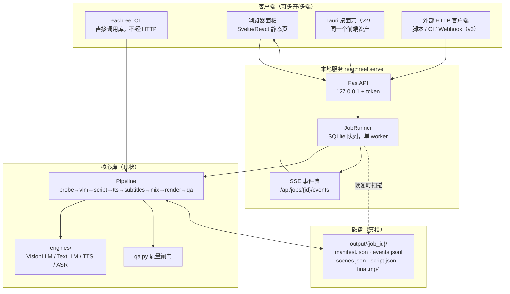
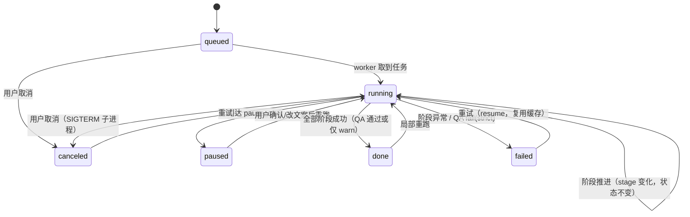

[English](../en/DESKTOP_ARCHITECTURE.md) | **简体中文**

# 桌面版与多前端架构

本文定义 ReachReel 从「命令行工具」走向「桌面面板 + CLI 双入口」的架构、契约和落地顺序。

结论先放在前面：**面板不做成原生 GUI，而是把 ReachReel 变成一个本地服务（`reachreel serve`），面板是它的第一个客户端。**
CLI、浏览器面板、未来的 Tauri 桌面壳、局域网里的 iPad，全部走同一套契约。

相关文档：[开发文档](DEVELOPMENT.md)、[路线图](ROADMAP.md)、[配置参考](CONFIGURATION.md)。

---

## 1. 产品定位

### 1.1 终局形态

ReachReel 的重心在代码里已经很清楚：`workdir + manifest.json + 缓存复用 + 阶段命令 + QA 闸门`。
这些指向的产品形态是**流水线/工厂**，不是剪辑软件。

| 方向 | 是否会走 | 理由 |
|---|---|---|
| 解说版时间线编辑器 | ❌ | 与剪映/CapCut/Descript 正面竞争，UI 投入无底洞 |
| **本地批量解说工厂** | ✅ | 无人值守、可恢复、质量闸门、隐私不出机器 |
| 云 SaaS | ❌ | 唯一优势是「画面不出机器」，上云即自毁 |
| 本地节点 + 远程界面 | ✅（v3） | 保住本地算力与隐私，同时获得多端/多人 |

**核心交互只有一件事：审文案 → 局部重跑。**

VLM 分析 18 个镜头要 20 分钟，改一行旁白只要 40 秒（复用 `scenes.json` 与 `vlm_cache.json`）。
界面的价值在于把「改一句 → 只重跑 `tts → subtitles → mix → render → qa`」变成一次点击，而不是一个大大的「开始」按钮。

### 1.2 为什么必须走本地服务

一句话：**算的机器和看的机器不需要是同一台。**

单条任务 10–40 分钟、20–32 GB 内存、Apple Silicon + MLX。终局必然出现：

```text
Mac mini（常驻渲染节点，插电放着）
   ↑ 局域网
iPad / 笔记本浏览器（在沙发上审文案、改一句、点重跑）
```

原生 GUI 把「界面」和「算力」焊死在同一台机器、同一个进程、同一个会话里，永远到不了这个形态。

| 场景 | 原生 GUI | 本地服务 + Web |
|---|---|---|
| 渲染 30 分钟 | 窗口不能关，合盖即断 | 关页面无影响，服务端继续跑 |
| 换设备 / 第二个人审稿 | 不行 | 浏览器打开即可 |
| 多平台客户端 | 写 N 个界面 | 一套前端 |
| 后续加 Tauri 壳 | — | 前端资产直接复用 |
| 自动化（CI / 监视目录 / 定时） | 另做 | HTTP API 天然有 |

原生 GUI 唯一的好处（系统集成、拖拽、通知、菜单栏）都能在 v2 用 Tauri 外壳补上，且不动前端。

---

## 2. 设计原则

1. **服务端是唯一入口。** CLI 与面板共享同一套 `Pipeline` / `JobRunner` 调用层，不各写一套逻辑。
2. **磁盘即真相。** 任务状态来自 `manifest.json` 与 `events.jsonl`，不是内存里的对象。进程重启后扫描 `output/` 重建任务列表。
3. **单 worker 串行队列。** MLX/Ollama 吃满内存，任务级并发只会 OOM。并发只发生在任务内部（`vlm_workers`）。
4. **本地优先，引擎可插拔。** MLX 是「arm64 上的加速后端之一」，不是唯一实现；远程模型是可选兜底，不是主路径。
5. **隐私边界靠近素材，交互边界远离机器。** 画面帧留在本机；只有文字摘要/旁白允许走远程。
6. **阶段级动作必须一一对应。** `reachreel tts <workdir>` ≡ `POST /api/jobs/{id}/stages {"stages":["tts"]}`。

---

## 3. 总体架构



**关键点**：CLI 不走 HTTP（离线、脚本、CI 都要能用），但和 `JobRunner` 调用同一个 `Pipeline`。
两者唯一的差别是「谁负责排队」——CLI 自己就是队列。

### 3.1 进程模型

```text
reachreel serve            # 一个 uvicorn 进程；默认只绑定 127.0.0.1
  └── worker thread/coroutine
        └── subprocess: python -m reachreel __run_job <job_id>
              └── Pipeline（MLX / Ollama / FFmpeg）
```

**长任务必须跑在子进程里。** 原因：

- MLX/Ollama 可能出现内存尖峰或直接崩，不能拖死 UI 服务；
- 「取消」= `SIGTERM` 到子进程树，干净利落；
- 子进程的标准输出就是事件源，天然结构化、天然可重连。

### 3.2 目录模型

```text
output/
  20251122_1430_snow_ski/      <- job_id（= workdir 名，已在 Pipeline 中生成）
    manifest.json              真相关于「这条任务」的一切
    events.jsonl               追加写的事件日志（SSE 可回放）
    scenes.json  vlm_cache.json
    script.json  timeline.json
    tts/*.wav    narration.wav
    subtitles.srt  subtitles.ass
    bgm_loop.wav  mix.wav
    final.mp4    qa.json    review.md
```

`job_id` 直接复用 `Pipeline.__init__` 现有的 `f"{video.stem}_{stamp}"` 规则，**不引入第二套 ID 体系**。

---

## 4. Job 模型

### 4.1 字段

```python
@dataclass
class Job:
    id: str                 # == workdir 名
    workdir: Path
    video_path: Path
    title: str              # 默认 video.stem，可改
    status: str             # queued|running|paused|done|failed|canceled
    stage: str | None       # 当前阶段（STAGE_ORDER 中的一项）
    stages: list[str]       # 本次计划执行的阶段（来自 --only / 审校重跑）
    params: dict            # 请求参数快照（brief/style/voice/height/burn...）
    pause_after: list[str]  # 例如 ["script"]：跑到该阶段后暂停等人工审校
    created_at / started_at / finished_at
    exit_code: int | None
    error: str | None       # 失败原因（人话，不是 traceback）
    qa_status: str | None   # pass|warn|fail
    output_path: Path | None
    elapsed_seconds: float
```

### 4.2 状态机



**恢复规则（重要）**：服务启动时执行

```text
对 output/*/ 每个 workdir：
  有 manifest.json + 有 events.jsonl 结束标记  -> 按 manifest 推出 done/failed
  有 manifest.json 但无结束标记                -> 标记 interrupted，附「可继续」动作
  无 manifest.json（只有中间产物）              -> 标记 queued（可从缓存继续）
```

不要依赖「内存里有没有这个任务」判断，只依赖磁盘。

### 4.3 阶段与产物（沿用现有定义）

| 阶段 | 标签 | 产物 | 可否单独重跑 |
|---|---|---|---|
| `probe` | 读取视频 | `scenes.json` | ✅ |
| `vlm` | 镜头检测 + 画面分析 | `vlm_cache.json` | ✅ |
| `script` | 写旁白 | `script.json` | ✅ |
| `tts` | 配音 + 时间轴 | `timeline.json`, `narration.wav` | ✅ |
| `subtitles` | 字幕 | `subtitles.srt`, `.ass` | ✅ |
| `mix` | 混音 | `mix.wav` | ✅ |
| `render` | 渲染成片 | `final.mp4` | ✅ |
| `qa` | 质量检查 | `qa.json` | ✅ |

别名沿用 `STAGE_ALIASES`（`analyze→vlm`、`timeline→tts`、`subtitle→subtitles`、`scenes→probe`）。

---

## 5. 事件协议

### 5.1 传输

- 落盘：`{workdir}/events.jsonl`，一行一个 JSON，追加写，`seq` 单调递增。
- 推送：`GET /api/jobs/{id}/events?since=<seq>`，`text/event-stream`，先回放 `seq > since` 的历史，再实时推送。
- 客户端断线重连只需带 `since`，**不会丢日志、不会重复渲染进度条**。

### 5.2 事件类型

```jsonc
// 任务开始
{"seq":1,"t":1732269000.1,"type":"job_start","job":"20251122_1430_snow_ski","stages":["probe","vlm","script","tts","subtitles","mix","render","qa"]}

// 阶段开始/结束
{"seq":2,"t":...,"type":"stage_start","stage":"vlm","label":"镜头检测 + VLM 画面分析","total":18,"reused":0}
{"seq":9,"t":...,"type":"stage_end","stage":"vlm","ok":true,"elapsed":812.3,"reused":0}

// 进度（可选，stage 内）
{"seq":5,"t":...,"type":"progress","stage":"vlm","done":7,"total":18,"unit":"镜头"}
{"seq":6,"t":...,"type":"progress","stage":"render","done":0.42,"total":1.0,"unit":"片段"}

// 日志（把现有 LOG.info 转成事件，同时仍然打到 stderr）
// 契约是 code + params；msg 是当前进程语言下的兜底渲染（见 LOCALIZATION.md §3.4）
{"seq":7,"t":...,"type":"log","level":"warning","stage":"mix","code":"bgm_not_found","params":{"dir":"inputs/bgm/"},"msg":"No BGM found in inputs/bgm/"}

// 产物就绪（面板据此刷新预览/按钮）
{"seq":8,"t":...,"type":"artifact","stage":"script","name":"script.json","path":"...","meta":{"segments":12,"chars":418}}

// QA 结论
{"seq":20,"t":...,"type":"qa","status":"warn","warn":2,"fail":0,"items":[{"kind":"subtitle_overflow","at":37.2,"msg":"字幕超框 12px"}]}

// 暂停（等待人工审校）
{"seq":15,"t":...,"type":"paused","stage":"script","reason":"pause_after"}

// 终止
{"seq":21,"t":...,"type":"job_end","status":"done","output":"output/xxx/final.mp4","qa_status":"warn","elapsed":1934.5}
{"seq":21,"t":...,"type":"job_end","status":"failed","exit_code":1,"error":{"code":"llm_unreachable","params":{"url":"http://localhost:11434"},"message":"Cannot reach Ollama","hint":"Run `ollama serve`"}}
```

### 5.3 实现方式（最小改动）

`util.setup_logging()` 增加一个 `sink` 参数：

```python
def setup_logging(verbose: bool = False, sink: Callable[[dict], None] | None = None) -> None: ...
```

`pipeline._run_stages` 里在阶段边界发 `stage_start/stage_end`；各阶段在「每完成一个单位」处发 `progress`（VLM 每镜头、TTS 每段、渲染每秒）。
**不改业务逻辑，只加埋点**；没传 `sink` 时行为与今天完全一致。

`render` 阶段需要真实的 FFmpeg 进度：给 `-nostats -progress pipe:1` 并解析 `out_time_ms`（`render.py` 现有命令上加两个参数 + 一个回调）。

---

## 6. HTTP API 契约

所有接口需带 `X-ReachReel-Token`（见 §10）。默认仅监听 `127.0.0.1`。

| 方法 | 路径 | 对应 CLI | 说明 |
|---|---|---|---|
| GET | `/api/health` | — | 版本、平台、是否忙、队列长度（免 token，仅本机） |
| GET | `/api/doctor` | `doctor --json` | 引擎/依赖/模型可用性矩阵，面板渲染成检查清单 |
| GET | `/api/engines` | — | 已注册引擎及 `available`（灰显不可用项） |
| POST | `/api/jobs` | `run` | 新建任务并入队。body: `{video, brief, preset, settings, only, pause_after}` |
| GET | `/api/jobs` | — | 列表，支持 `?status=&limit=` |
| GET | `/api/jobs/{id}` | — | 详情：manifest 摘要 + 阶段状态 + QA |
| GET | `/api/jobs/{id}/events` | `run --emit-events` | SSE，支持 `?since=` |
| POST | `/api/jobs/{id}/cancel` | — | `SIGTERM` 子进程树 |
| POST | `/api/jobs/{id}/retry` | `run --workdir` | 从缓存继续，保留已知阶段 |
| POST | `/api/jobs/{id}/stages` | `script/tts/subtitle/mix/render/qa` | `{stages:[...], force:false}`，**局部重跑的唯一入口** |
| GET/PUT | `/api/jobs/{id}/script` | 手改 `script.json` | 审校页读写；PUT 后建议自动触发 `tts→…→qa` |
| GET | `/api/jobs/{id}/preview/{name}` | — | 白名单文件回放：`final.mp4`、`narration.wav`、`tts/seg_007.wav` |
| POST | `/api/jobs/{id}/reveal` | — | 在访达/资源管理器里显示（`open -R` / `explorer /select,` / `xdg-open`） |
| GET/PUT | `/api/settings` | `config.toml` | 面板设置；密钥单独走 Keychain，不回显明文 |

**约定**：
- 任何写操作返回 `{job, events_url}`，前端据此订阅，不做乐观更新。
- 错误统一 `{"error": {"code": "...", "params": {...}, "message": "当前语言渲染结果", "hint": "下一步怎么办"}}`；`code` 是已本地化契约，面板自行翻译。
- 语言：服务端输出与客户端展示语言解耦，详见 [LOCALIZATION.md](LOCALIZATION.md)。
- `/api/jobs` 的 `settings` 是**覆盖项**，与 CLI 参数同义（复用 `cli._overrides` 的字段表，避免两套参数名）。

---

## 7. 局部重跑（审校循环）

这是产品的核心闭环，实现上完全依赖已有能力：

```text
用户在审校页改第 7 段旁白
  → PUT /api/jobs/{id}/script
  → POST /api/jobs/{id}/stages {"stages":["tts","render","qa"]}
      （服务端自动补齐依赖：tts 之后必须 subtitles、mix，然后才能 render）
  → SSE 推 stage_start(tts) ... artifact(final.mp4) ... qa
  → 面板只刷新第 7 段的时间与试听，不整页重载
```

**依赖补齐规则**（服务端做，别指望用户懂）：

| 用户请求 | 实际执行 |
|---|---|
| `script` | `script`（不动下游，让用户先看稿） |
| `tts` | `tts → subtitles → mix → render`（+qa） |
| `subtitles` | `subtitles → mix?（否）→ render` |
| `render` | `render`（+qa） |
| 任意 + `force=false` | 复用现有缓存，只重做受影响段 |

TTS 已按文本增量合成（`tts/*.wav` 以文本哈希命名），所以「只改一句」时只有那一段重新推理。

---

## 8. 引擎抽象（跨平台 + 远程）

### 8.1 现状与目标

当前 `mlx-audio` / `mlx-whisper` 是 Apple Silicon 独占。但代码边界已经很好：

- `vlm.py` 走 `POST {base_url}/v1/chat/completions` + Bearer → **已经是 OpenAI 兼容协议**，换 `base_url`/`api_key` 就能调远程。
- `tts.py:67`、`subtitles.py:297` 都是**函数内延迟导入**，天然可替换。
- `misaki[zh]`（中文 G2P）是纯 Python，跨平台可用 → 换 TTS 只需换声码器推理后端。

### 8.2 四个接口

```python
# src/reachreel/engines/base.py
class VisionLLM(Protocol):
    name: str; location: Literal["local", "remote"]; available: bool
    def describe(self, images: list[Path], prompt: str) -> str: ...

class TextLLM(Protocol):
    name: str; location: Literal["local", "remote"]; available: bool
    def chat(self, messages: list[dict], **kw) -> str: ...

class TTS(Protocol):
    name: str; location: Literal["local", "remote"]; available: bool
    def synthesize(self, text: str, voice: str, speed: float) -> tuple[bytes, int]: ...  # (PCM, sample_rate)

class ASR(Protocol):
    name: str; location: Literal["local", "remote"]; available: bool
    def spans(self, wav: Path, language: str) -> list[Span]: ...   # 只要语音边界
```

### 8.3 引擎矩阵

| 能力 | macOS arm64 | Windows / Linux | 远程 |
|---|---|---|---|
| VLM | Ollama `qwen3-vl`（现有） | Ollama / LM Studio / llama.cpp | 任意 OpenAI 兼容（Qwen-VL、Gemini、OpenAI） |
| LLM | Ollama `qwen3`（现有） | 同上 | 任意 OpenAI 兼容 |
| TTS | `kokoro-mlx`（现有） | `kokoro-onnx`（CPU 可跑，G2P 复用 misaki） | OpenAI `tts-1`、DashScope CosyVoice、MiniMax |
| ASR | `mlx-whisper`（现有） | `faster-whisper`（CTranslate2 int8，CPU 够用） | OpenAI Whisper、Groq |
| `say` | macOS only（保留为兜底） | — | — |

**推荐兜底组合**（面板只给两个开关，别让用户配 4 个后端）：

```text
默认「全本地」   VLM 本地 · LLM 本地 · TTS 本地 · ASR 本地
「轻量远程」     VLM 本地（画面不出机器） · LLM 远程 · TTS 本地/远程 · ASR 本地
```

> 只把「写文案」这一步放到远程，是隐私与算力的最优折中：上传的只有场景摘要文字，不是画面。

### 8.4 配置分组

```toml
[vlm]
provider = "ollama"          # ollama | openai
base_url = "http://localhost:11434"
model    = "qwen3-vl:8b-instruct"
api_key_env = "REACHREEL_VLM_KEY"

[llm]
provider = "openai"
base_url = "https://dashscope.aliyuncs.com/compatible-mode"
model    = "qwen3-max"
api_key_env = "DASHSCOPE_API_KEY"

[tts]
provider = "kokoro-mlx"      # kokoro-mlx | kokoro-onnx | openai | say
voice    = "zf_xiaoxiao"

[asr]
provider = "mlx-whisper"     # mlx-whisper | faster-whisper | openai
model    = "mlx-community/whisper-large-v3-turbo"
```

向后兼容：旧的扁平键（`ollama_url`、`vlm_model`、`llm_model`、`tts_engine`、`whisper_model`）继续有效，加载时映射到新分组，优先级不变（默认值 < toml < 环境变量 < CLI）。

**密钥不进 toml**：macOS Keychain（`security add-generic-password`）、Windows DPAPI、Linux `secret-tool`；退路是 `api_key_env` 指向的环境变量。面板用掩码输入。

### 8.5 缓存键必须带 provider

`vlm.py` 现有键：

```python
settings_key = f"{model}|{PROMPT_VERSION}|{max_width}|{context}"
```

本地 `qwen3` 与远程 `qwen3-max` 会撞缓存。改为：

```python
settings_key = f"{provider}|{base_url_host}|{model}|{PROMPT_VERSION}|{max_width}|{context}"
```

TTS/ASR 的文本哈希键同理，加入 `provider` 与 `voice`/`model`。

### 8.6 doctor 输出

```bash
reachreel doctor --json
```

```json
{"platform":{"os":"macos","arch":"arm64","py":"3.12.7"},
 "engines":{
   "vlm":{"provider":"ollama","location":"local","ok":true,"detail":"qwen3-vl:8b-instruct 已就绪"},
   "llm":{"provider":"ollama","location":"local","ok":true,"detail":"..."},
   "tts":{"provider":"kokoro-mlx","location":"local","ok":true,"detail":"..."},
   "asr":{"provider":"mlx-whisper","location":"local","ok":true,"detail":"..."}},
 "deps":{"ffmpeg":{"ok":true,"path":"/opt/homebrew/opt/ffmpeg-full/bin/ffmpeg","libass":true},
         "fonts":{"ok":true,"path":".../NotoSansSC-Subset.otf"}},
 "notes":["内存 16 GB：建议 vlm_workers = 1"]}
```

---

## 9. 跨平台必需修复（P0，先于面板）

面板之前必须先修完这 6 条，否则 Windows/Linux 连跑都跑不起来。

| # | 位置 | 问题 | 修法 |
|---|---|---|---|
| 1 | `util.py:42` | `subprocess.run(text=True)` 用系统编码解码，Windows 上 FFmpeg 输出中文路径会 `UnicodeDecodeError` | 加 `encoding="utf-8", errors="replace"` |
| 2 | `config.py:53` | `subtitle_font = "PingFang SC"` 仅 macOS；缺失时 libass 静默回退 → 字宽变化 → QA「字幕超框」误报 | 随包分发子集化思源黑体/Noto Sans SC，`subtitles` 滤镜加 `fontsdir=`，`FontName` 固定 |
| 3 | `pyproject.toml` | MLX 依赖在 Windows/x86 上安装直接失败 | 拆 extras：`accel-mlx` / `cpu` / `gui`；`misaki[zh]` 留在主依赖 |
| 4 | 依赖树 | `torch` 装了 580 MB 但代码零 import；Windows CUDA 版更夸张 | 构建时剔除，或 `--no-deps` 精确安装 |
| 5 | 全局 | 路径依赖 CWD（`output/`、`inputs/bgm/`），`.app`/`.exe` 里必然失败 | `platformdirs`：`~/Library/Application Support/ReachReel`、`%APPDATA%\ReachReel`、`~/.local/share/reachreel` |
| 6 | `util.py:94` | FFmpeg 探测硬编码 Homebrew 路径 | 增加「应用自带 `<resources>/bin/ffmpeg`」并优先；Windows 用 BtbN GPL 静态包，Linux 用 johnvansickle static |

其他平台细节：Windows 长路径（workdir 用短 ID，不展开中文名）、`vlm_workers` 默认值按平台（Windows 显存回收慢，默认 1）、`say` 引擎标为 macOS-only。

---

## 10. 安全模型

面板是本机工具，不是公网服务。硬性约束：

1. **默认绑定 `127.0.0.1`**，端口随机或 8760 起。
2. **启动时生成一次性 token**，写入 `~/.reachreel/token`（权限 0600），前端由 `serve --open` 通过 URL fragment 注入；所有 `/api/*` 校验 `X-ReachReel-Token`（`/api/health` 除外）。
3. **不做 CORS**，静态资源与 API 同源；校验 `Origin`/`Host` 头，拒绝跨站请求（`Sec-Fetch-Site` 检查）。
4. **文件接口白名单**：`/preview/{name}` 只允许 `final.mp4`、`narration.wav`、`mix.wav`、`subtitles.srt`、`tts/*.wav`，禁止任意路径拼接。
5. **远程访问需显式开启**：`serve --host 0.0.0.0 --password ...`，并在设置页显著提示「这不是公网服务」。文档里写清楚不要做端口映射。
6. `POST /api/jobs` 的 `video` 只接受本机存在的路径；上传走单独的临时目录，不写入 `output/`。

---

## 11. 打包与分发

| 层 | 选型 |
|---|---|
| 外壳 | **Tauri**（v2）：一套前端，产物 `.dmg` / NSIS `.exe` / `.AppImage`；外壳 10–20 MB |
| Python | python-build-standalone，依赖装进解释器自身 `site-packages`（**不要 ship venv**，venv 里有绝对路径） |
| 依赖 | 按平台 extras：mac 用 MLX，Win/Linux 用 onnx + faster-whisper |
| FFmpeg | 自带（三平台都要 libass），`FFMPEG_FULL` 指向 `<resources>/bin/ffmpeg` |
| 字体 | 自带子集化中文字体（OFL），保证三平台字幕渲染一致 |
| 更新 | Tauri updater；模型与 Ollama 不进安装包，首次运行下载 |

体积目标（剔除 torch 后）：macOS arm64 **450–600 MB**，Windows x64 **550–700 MB**，Linux x64 **550–700 MB**。
不打包 CUDA；GPU 用户自行安装 `onnxruntime-gpu`。

签名：macOS 用 Developer ID + `notarytool`（需要 `com.apple.security.cs.allow-jit`、`com.apple.security.cs.disable-library-validation` 权限）；Windows 用 Authenticode 或 Azure Trusted Signing；Linux 发布 AppImage + 校验和。
**不上 App Store**（GPL FFmpeg、Ollama 外挂、运行时下载模型）。

---

## 12. v1 范围

### 做

| 页面 | 内容 |
|---|---|
| 新建 | 拖视频 / 粘贴路径 / 监视 `inbox/`；`brief`、预设（旅行/城市/产品/竖屏）、`dry-run` 预览将执行哪些阶段与复用情况 |
| 队列 | 卡片列表：缩略图、时长、状态、阶段进度、ETA、磁盘占用；排序、暂停、取消、重试 |
| 详情 | 阶段时间线（完成/复用/重跑）、实时日志、QA 报告（红黄绿，可跳到对应时间点） |
| 审校 | 逐段旁白编辑、单段试听、单段重跑（→ `tts→render→qa`）、字幕行预览 |

技术栈：后端 FastAPI + SQLite + SSE；前端 Svelte 或 React + Vite + Tailwind，纯静态托管（不要 Next.js/SSR）。
估算：后端 800–1200 行，前端 1500–2500 行，**约 2 周**（事件与阶段命令已存在，写的是「搬运 + 展示」）。

### 不做

时间线编辑、多轨音频、转场特效、素材云盘、账号体系、App Store、Windows GPU、多机分布式、Gradio/Streamlit 式单页表单。

**不要用 Gradio/Streamlit**：起得快，但会锁死在「单页表单」里，审校循环、队列、断线重连都做不了。

---

## 13. 演进路线

```text
v1（约 2 周）  本地 Web 面板：单机、单队列、4 页面、审校循环；CLI 不变
              验收：两条真实素材在浏览器里从头跑到成片，改一句只重跑 40 秒

v2（约 1 个月）Tauri 壳（同一前端：双击即用、拖拽、通知、菜单栏常驻）
              + 预设模板 + 批量（拖一个文件夹 = N 个 job）+ 引擎矩阵图形化
              + P0 跨平台修复完成，Windows/Linux 能出片

v3（约 3 个月）渲染节点模式：Mac mini 常驻，局域网多人访问；
              项目经理审稿 + 剪辑只收成片；对外 HTTP API / Webhook
```

v3 不是「上云」，而是「本地节点 + 远程界面」：算力与素材留在本机，交互延伸到任意设备。

---

## 14. 待决策

| 事项 | 建议 | 状态 |
|---|---|---|
| Windows GPU（CUDA）是否进第一版 | 不进，先 CPU + 远程 | 待定 |
| 远程默认 provider 文档用哪家 | 只写「任意 OpenAI 兼容 + 自定义 base_url」，不绑厂商 | 待定 |
| 面板功能是否 100% 对齐 CLI | 对齐（走同一 JSONL 协议） | 建议通过 |
| 跨平台定义 | 「三平台体验一致」设计、「Win/Linux 能出片」验收 | 建议通过 |
| v1 是否先手写一个极简 HTML 验证事件流 | 是，最多浪费两天，避免两周返工 | 建议通过 |

---

## 15. 落地顺序

**P0 · 正确性（不改架构，约 1 周）**
1. `util.run` 编码
2. `platformdirs` 路径
3. 拆 extras、剔 `torch`
4. 内置子集化字体 + `fontsdir`
5. FFmpeg 探测加「自带优先」
6. `doctor --json`
7. 测试：非 ASCII 文件名、竖屏、路径含空格

**P1 · 服务化（约 2 周）**
8. `src/reachreel/events.py`：`EventSink` + `events.jsonl` + `pipeline._run_stages` 埋点
9. `src/reachreel/jobs.py`：SQLite 任务表、单 worker 队列、启动扫描恢复
10. `src/reachreel/server/app.py`：REST + SSE + token
11. `src/reachreel/cli/main.py` 加 `serve`、`run --emit-events`
12. 前端四页（先手写 200 行 HTML 验证，再上框架）

**P2 · 引擎与远程（约 2 周）**
13. `engines/` 四接口 + registry（MLX 搬过去当默认）
14. 远程 provider + 密钥存储 + 缓存键加 provider
15. `faster-whisper` ASR（收益最大：Win/Linux 立即可用）
16. `kokoro-onnx` TTS

**P3 · 打包（约 1 周）**
17. Tauri 壳、三平台构建脚本、签名公证、更新通道

---

## 16. v1 验收标准

- [ ] `reachreel serve --open` 一条命令打开面板，浏览器里能看到已有 `output/` 任务
- [ ] 浏览器里新建任务 → 跑完 → 队列状态、ETA、日志、QA 全可见
- [ ] 关掉浏览器 10 分钟再打开，进度与日志不丢（SSE 回放）
- [ ] `Ctrl-C` / 取消 → 子进程被清理，不留孤儿 FFmpeg/Ollama 请求
- [ ] 审校页改一段旁白 → 只重跑 `tts→render→qa`，耗时 < 1 分钟
- [ ] 服务重启后，`interrupted` 任务可一键继续（复用缓存）
- [ ] 所有 CLI 命令行为与今天完全一致（无 GUI 依赖、无 HTTP 依赖）
- [ ] 面板每个阶段显示「本地/远程 · 模型名」徽标
- [ ] 未装 Ollama / 缺模型 / 缺 FFmpeg 时，面板给出可点击的修复指引，而不是栈回溯
