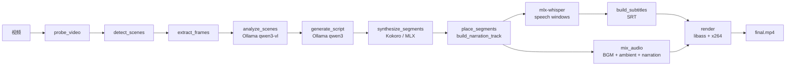

[English](../en/DEVELOPMENT.md) | **简体中文**

# 开发文档

本文面向要改代码、加功能、排查问题的人。使用说明见 [USER_GUIDE.md](USER_GUIDE.md)，配置见 [CONFIGURATION.md](CONFIGURATION.md)。

---

## 1. 设计目标

ReachReel 不是“另一个大而全的视频编辑器”，而是一个**可读、可改、可恢复**的本地流水线：

- 每个阶段有明确输入/输出文件；
- 中间产物可复用，改文案只重跑受影响阶段；
- 默认全本地，不引入云 API；
- 先跑通“看画面 → 写稿 → 配音 → 字幕 → 混音 → 成片”，再逐步加能力；
- 代码量控制在可维护范围，不为了功能堆框架。

---

## 2. 总体架构



入口：`src/reachreel/cli/main.py`。编排：`src/reachreel/pipeline/orchestrator.py` 的 `Pipeline`。

### 阶段顺序

```text
prepare_scenes
  ├─ probe_video
  ├─ detect_scenes
  └─ extract_frames
understand
  └─ analyze_scenes
write_script
  ├─ generate_script
  └─ write_script_md（人工确认闸门）
make_voice
  └─ synthesize_segments
make_timeline
  ├─ place_segments
  └─ build_narration_track
make_subtitles
  └─ build_subtitles
make_mix
  ├─ pick_bgm
  ├─ prepare_bgm_loop
  └─ mix_audio
render_final
  └─ render
write_manifest
write_review
qa
  └─ run_qa
```

---

## 3. 模块地图

| 文件 | 职责 | 关键函数/类 |
|---|---|---|
| `src/reachreel/cli/main.py` | 参数解析、子命令 | `main`, `build_parser` |
| `src/reachreel/core/config.py` | 配置 dataclass、TOML、环境变量、优先级 | `Settings`, `Settings.load` |
| `src/reachreel/core/util.py` | 子进程、ffprobe、JSON、时间戳 | `run`, `ffprobe_json`, `ffmpeg_full`, `srt_timestamp` |
| `src/reachreel/core/cache.py` | 共享缓存路径、视频指纹、清理 | `cache_root`, `video_key`, `cache_stats`, `clean_cache` |
| `src/reachreel/i18n/__init__.py` | CLI/UI 语言协商与文案目录 | `t`, `set_language`, `negotiate_language` |
| `src/reachreel/prompts/__init__.py` | Prompt 包与内容文案目录加载 | `load_prompt`, `load_content`, `text` |
| `src/reachreel/prompts/{zh,en}/` | 语言相关 prompt 与 fallback 数据 | `vlm.txt`, `script.txt`, `style.txt`, `messages.toml` |
| `src/reachreel/domain/models.py` | 共享领域模型 | `VideoInfo`, `Scene`, `NarrationSegment`, `Cue`, `QualityFlag` |
| `src/reachreel/domain/timeline.py` | 旁白落点、整体加速、旁白轨 | `place_segments`, `build_narration_track` |
| `src/reachreel/engines/vlm.py` | Ollama OpenAI 兼容客户端、VLM prompt、缓存 | `OllamaClient`, `analyze_scenes` |
| `src/reachreel/engines/tts.py` | Kokoro / say 合成、文本切分、缓存 | `KokoroEngine`, `SayEngine`, `synthesize_segments` |
| `src/reachreel/generation/script.py` | 写稿、压缩/扩写、兜底 | `generate_script` |
| `src/reachreel/media/scenes.py` | 视频探测、镜头检测、抽帧 | `probe_video`, `detect_scenes`, `extract_frames` |
| `src/reachreel/media/subtitles.py` | Whisper 转写、语音窗口、SRT、ASS 布局 | `cues_from_timeline`, `build_subtitles`, `write_ass` |
| `src/reachreel/media/audio.py` | BGM 选择/循环、曲目元数据、授权导出、侧链闪避、响度 | `pick_bgm`, `mix_audio`, `bgm_metadata`, `bgm_license_markdown` |
| `src/reachreel/media/render.py` | 缩放/帧率、硬字幕/软字幕、封装 | `render`, `subtitle_style` |
| `src/reachreel/media/edit_export.py` | 干净画面编码与剪辑时间线 XML 序列化 | `write_edit_bundle` |
| `src/reachreel/pipeline/orchestrator.py` | 阶段编排、缓存、manifest、doctor | `Pipeline`, `doctor`, `doctor_report` |
| `src/reachreel/pipeline/stage_inputs.py` | 流水线与独立 QA 共用的输入校验 | `StageInputs` |
| `src/reachreel/pipeline/qa.py` | 成片质量闸门 | `run_qa`, `print_report`, `parse_srt` |
| `scripts/check_commit_messages.py` | Conventional Commits 校验器，pre-commit hook 与 CI 共用 | `validate`, `messages_in_range` |
| `scripts/apdev_charset.json` | `apdev check-chars` 的字符集：ASCII + emoji + CJK 标点，汉字仍然非法 | — |
| `scripts/check_config_docs.py` | 配置项三处一致：`Settings` ↔ `config.example.toml` ↔ 两份 `CONFIGURATION.md` | `settings_fields`, `compare` |
| `scripts/check_changelog.py` | `CHANGELOG.md` / `CHANGELOG.zh-CN.md` 结构一致性 | `parse`, `compare`, `main` |

---

## 4. 数据格式

所有中间文件都在 `workdir/` 下，使用 UTF-8 JSON。

### 4.1 `scenes.json`

```json
{
  "video": {
    "path": "/abs/path/video.mp4",
    "duration": 92.891667,
    "width": 3840,
    "height": 2160,
    "fps": 59.94,
    "has_audio": true,
    "audio_channels": 2,
    "audio_sample_rate": 44100,
    "rotation": 0.0,
    "coded_width": 3840,
    "coded_height": 2160
  },
  "scenes": [
    {
      "id": 1,
      "start": 0.0,
      "end": 7.74,
      "frames": ["/abs/workdir/frames/scene_0001_00.jpg"],
      "summary": "观光船靠近尼亚加拉瀑布，游客穿雨衣观景",
      "details": ["白色水雾", "绿色河水", "阴天"],
      "mood": "壮阔",
      "place": "尼亚加拉瀑布",
      "hint": "从水雾和船的行进角度写",
      "subjects": ["游客", "观光船"],
      "actions": ["乘船靠近瀑布"],
      "duration": 7.74
    }
  ]
}
```

- `width` / `height` 是**显示分辨率**：如果视频带 90°/270° 旋转元数据，会交换宽高。
- `coded_width` / `coded_height` 是旋转前的编码尺寸；`0` 表示早于这两个字段的旧工作目录。
- `frames` 是绝对路径。
- `inputs_key` 记录原片以及镜头检测、抽帧所用的配置。执行 VLM 阶段时可以刷新缺少此键的旧 `scenes.json`。
- VLM 字段可能为空；脚本阶段有兜底。

### 4.2 `vlm_cache.json`

```json
{
  "settings": "<settings-hash>",
  "scenes": {
    "<scene-hash>": {
      "summary": "...",
      "place": "...",
      "subjects": [],
      "actions": [],
      "details": [],
      "mood": "...",
      "narration_hint": "...",
      "raw": "..."
    }
  }
}
```

- `settings` 记录 VLM 端点、成片语言、模型、提示词及其版本、抽帧宽度、去重阈值和 `brief` 的指纹。
- 每个镜头的键包含镜头 ID、起止时间和按序排列的帧内容指纹。相同输入可跨工作目录复用结果。
- 缓存保存成功的分析结果。后续运行可重试失败或降级的镜头，包括缺少关键帧或无法解析模型响应的情况。旧缓存键会在使用时重建。
- `--force` 跳过工作目录和共享缓存的读取。强制重跑得到的成功结果可重新写入缓存。

### 4.3 `script.json`

```json
{
  "content_language": "zh",
  "segments": [
    {
      "id": 1,
      "scene_ids": [1, 2, 3],
      "text": "水声越来越大，船正往瀑布腹地开。",
      "audio_path": "",
      "duration": 0.0,
      "start": 0.0,
      "end": 0.0,
      "tts_speed": 1.0
    }
  ]
}
```

- `text` 是人工可编辑字段；
- `audio_path` / `duration` / `start` / `end` / `tts_speed` 由后续阶段回填；
- `scene_ids` 决定旁白锚定到哪个场景。
- 自动生成的稿件还记录 `generation.inputs_key`（写稿输入）和 `generation.segments_key`（生成的段落）。正常续跑用这些哈希值判断是否需要更新生成稿，同时保留人工编辑过的稿件。旧版本的稿件在成片语言一致时仍可复用。

### 4.4 `timeline.json`

```json
{
  "segments": [
    {
      "id": 1,
      "scene_ids": [1, 2, 3],
      "text": "...",
      "audio_path": "/abs/workdir/tts/seg_001_abcd1234.wav",
      "duration": 7.28,
      "start": 0.7,
      "end": 7.98,
      "tts_speed": 1.0
    }
  ],
  "total_chars": 203
}
```

### 4.5 `manifest.json`

关键字段：

```json
{
  "schema_version": 2,
  "video": { "...": "同 scenes.json" },
  "workdir": "...",
  "output": "...",
  "settings": {
    "vlm_model": "...",
    "llm_model": "...",
    "tts_engine": "kokoro",
    "voice": "zf_xiaoxiao",
    "whisper_model": "...",
    "bgm": "...",
    "burned_subtitles": true
  },
  "render_settings": {
    "output_height": 1920,
    "output_fps": 30,
    "crf": 20,
    "subtitle_size": 56,
    "subtitle_render": "outline",
    "subtitle_outline": 0.0,
    "subtitle_box_padding": 0.0,
    "subtitle_size_unit": "px",
    "subtitle_layout": "ass",
    "subtitle_max_chars": 14,
    "subtitle_margin_v": 220,
    "burn_subtitles": true
  },
  "settings_snapshot": {
    "ollama_url": "http://localhost:11434",
    "vlm_model": "qwen3-vl:8b-instruct",
    "llm_model": "qwen3:30b-instruct",
    "voice": "zf_xiaoxiao",
    "tts_engine": "kokoro",
    "...": "完整 Settings 快照，供阶段命令恢复"
  },
  "bgm_source": "/abs/inputs/bgm/ski-ukulele.mp3",
  "bgm_metadata": {
    "file": "ski-ukulele.mp3",
    "title": "...",
    "author": "...",
    "source": "https://...",
    "license": "CC0-1.0"
  },
  "cache": {
    "enabled": true,
    "dir": "/Users/you/.cache/reachreel",
    "video_key": "5c1f..."
  },
  "quality_flags": [
    {
      "code": "asr.fallback",
      "params": {"engine": "mlx-whisper", "model": "..."},
      "severity": "warning"
    }
  ],
  "scenes": 12,
  "narration_segments": 5,
  "narration_chars": 146,
  "narration_seconds": 33.4,
  "timeline": [],
  "elapsed_seconds": 220.6,
  "qa": {
    "pass": 17,
    "warn": 0,
    "fail": 0,
    "status": "pass",
    "exit_code": 0
  }
}
```

`settings_snapshot` 保存当前任务设置，供下次命令使用。从清单版本 2 起，`render_settings` 记录最近一次成功渲染的设置，供 QA 使用，仅在渲染成功时更新。旧版清单保存的设置仍可用于续跑。

`artifact_inputs` 记录阶段输入指纹，成功渲染时也会记录已发布的成片和硬字幕侧文件。媒体身份使用采样指纹和修改时间。TTS 的镜头指纹只涵盖切点与时长，修改画面描述本身不会使旁白时间轴失效。独立 QA 和流水线通过 `StageInputs` 共用检查逻辑。旧工作目录在对应阶段重跑前会利用已有指纹与修改时间判断。

`quality_flags` 记录没有中断流程的降级情况。当前 code：

| Code | 含义 |
|---|---|
| `vlm.scene_failed` | 单个场景重试后仍失败，摘要使用了回退文本。 |
| `vlm.no_frames` | 场景没有可用的关键帧。 |
| `vlm.unparsed` | VLM 返回的内容不是合法 JSON。 |
| `tts.segment_failed` | 单段配音重试后仍失败并被跳过。 |
| `asr.fallback` | Whisper 不可用或失败，字幕时间回退到 TTS 时间轴。 |
| `asr.empty` | `subtitle_text = "asr"` 时 Whisper 没有返回 cue。 |
| `qa.warn` / `qa.fail` | QA 门禁报出警告或失败。 |

`bgm_metadata` 在曲目存在于目录中时从 `inputs/bgm/manifest.json` 复制；`reachreel licenses <workdir>` 会把它渲染成 `licenses.md`。

### 4.6 其他文件

| 文件 | 说明 |
|---|---|
| `frames/*.jpg` | 每个镜头的关键帧 |
| `tts/seg_XXX_<hash>.wav` | 每段配音，48k 单声道 |
| `narration.wav` | 全片旁白轨，含静音间隔 |
| `bgm_loop.wav` | 循环到视频长度的 BGM |
| `mix.wav` | 最终混音 |
| `subtitles.srt` | 字幕（软字幕/兼容） |
| `subtitles.ass` | 硬字幕布局，`PlayResX/Y` = 输出分辨率 |
| `script.md` | 供人工确认的脚本预览 |
| `qa.json` | QA 闸门结果 |
| `licenses.md` | `reachreel licenses` 导出的 BGM 授权清单 |
| `final.mp4` | 成片 |
| `edit/` | 可选剪辑素材包，`edit/manifest.json` 记录包内相对文件名 |

### 4.7 共享缓存（可选）

跨工作目录缓存与工作目录分开：

```text
~/Library/Caches/reachreel/   # 平台缓存目录；旧 ~/.cache/reachreel 会被复用
├── vlm/<video_key>.json   # 按视频采样指纹复用 VLM 结果
└── tts/<hash>.wav         # 按 engine/model/voice/speed/text 复用分段音频
```

VLM 文件沿用 `vlm_cache.json` 的结构。`cache_dir` 可改根目录；`cache_enabled = false`、`REACHREEL_CACHE=0` 或 `--no-cache` 可关闭。`reachreel cache info` / `cache clean --yes` 用于查看和清理。

---

## 5. 关键算法

### 5.1 镜头检测

`scenes.detect_scenes`：

1. 用 FFmpeg 的 scene 分数找硬切：

   ```bash
   ffmpeg -i video -filter:v "select='gt(scene,0.32)',showinfo" -an -f null -
   ```

2. 从 stderr 解析 `pts_time:`。
3. 加首尾边界，得到原始区间。
4. 长于 `max_scene_seconds` 的区间切块。
5. 短于 `min_scene_seconds` 的区间尝试与前一区间合并。
6. 超过 `max_scenes` 时均匀合并。
7. 如果完全没有区间，兜底为一个完整场景。

> 当前没有使用 PySceneDetect，也没有镜头内运动聚类；这是后续可改进点。

### 5.2 抽帧

`extract_frames`：

- 每个场景按 `vlm_frames_per_scene` 在 `[start+pad, end-pad]` 均匀取时间点；
- 用 `ffmpeg -ss T -i video -frames:v 1 -vf scale=...` 抽帧；
- `ThreadPoolExecutor` 并发 4；
- 输出 `frames/scene_XXXX_YY.jpg`。
- 随后做去重：每帧降采样成 16×16 灰度缩略图，如果与上一张保留帧的平均绝对像素差低于 `vlm_frame_dedup`（默认 `4.0`，`0` 关闭），就删掉该文件并从 `scenes.json` 的 `frames` 里移除。`select_representative_frames` 是纯函数，所以规则不依赖 FFmpeg 也能做单测。
- 该阈值计入 VLM 缓存 key（`engines.vlm.settings_key`），因为它改变了模型实际看到的帧。

### 5.3 VLM 分析

`vlm.analyze_scenes`：

- 使用 Ollama 的 OpenAI 兼容端点 `/v1/chat/completions`；
- 每个场景发送 1–3 张图 + 中文 JSON prompt；
- 输出字段：`summary` `place` `subjects` `actions` `details` `mood` `narration_hint`；
- `brief` 会作为“已知背景”注入 prompt；
- 解析失败时保留 raw 文本，尽量不中断；
- 按 `scene_id:start:end` 缓存。

### 5.4 写稿

`script.generate_script`：

1. 计算目标字数：

   ```text
   target_chars = duration × speech_chars_per_second × narration_density
   ```

2. 生成场景表，要求 LLM 输出 JSON 数组：

   ```json
   [{"scene_ids": [1,2], "text": "..."}]
   ```

3. 至少有 `min_segments = duration / 14` 段（最多 10 段）；
4. 总字数超过 `1.22 × target` → 请求压缩；
5. 总字数低于 `0.72 × target` 且时长 > 25s → 请求扩写；
6. JSON 解析失败 → 用场景摘要生成兜底稿。

> 没有做严格的事实校验；`brief` 和 prompt 约束是主要防幻觉手段。

### 5.5 TTS

`tts.synthesize_segments`：

- 使用 `mlx_audio` 加载 Kokoro；
- 文本按标点切到 ≤70 字，避免长句不稳定；
- 每段合成后拼接，chunk 之间 120ms 静音；
- 24k → 48k / mono / PCM S16；
- 缓存 key = `engine|model|voice|speed|text`；
- `say` 引擎是 macOS 调试兜底。

### 5.6 时间轴

`timeline.place_segments`：

```text
anchor = 该段第一个场景的 start
start  = max(anchor, cursor)
end    = start + duration
cursor = end + min_gap_seconds
```

如果最后一段超出视频：

```text
factor = (last_end - start_offset) / (duration - tail_padding - start_offset)
factor = clamp(factor, 1.0, max_speedup)
```

对每段应用 `atempo=factor`，重新落点。

`build_narration_track`：

- 用 numpy 建 48k 静音轨；
- 按 `start` 把每段 wav 叠加进去；
- 12ms 淡入淡出，避免爆音；
- 峰值超过 0.98 时整体衰减。

### 5.7 字幕

`subtitles.build_subtitles`：

1. 用 `mlx-whisper` 转写 `narration.wav`，拿 `segments` / `words`；
2. 对每个旁白段，找重叠的 Whisper 段，得到更精确的语音起止窗口；
3. 用**原稿文字**按 `subtitle_max_chars` 和 `subtitle_max_lines` 切行：中文优先标点边界，空格语言按整词打包；
4. 在语音窗口内按“字数 + 句末/逗号停顿加成”分配时间；
5. 生成 SRT。

关键点：

**样式**（`subtitles.subtitle_border`、`subtitle_render`）：

- `outline`（默认）：`BorderStyle=1`，白色填充、黑色描边色，描边宽度取 `subtitle_outline`，未设置时约为 `subtitle_size` 的 6%，另加轻微阴影。描边只覆盖笔画边缘，字后画面仍然可见；
- `box`：`BorderStyle=3`，旧的半透明黑底色块（`BackColour=&H80000000`），内边距为 `height / 288`，设置了 `subtitle_box_padding` 时以它为准；
- `none`：`BorderStyle=1` 且 `Outline=0`、`Shadow=0`，即纯白字、无描边。

因为 `PlayResX/Y` 等于输出分辨率且 `ScaledBorderAndShadow: yes`，描边宽度就是真实像素。

其他关键点：

- 不使用 ASR 文字，避免同音错字；
- 不会丢字：`_cue_texts` 保证所有字符进入某条字幕；
- 每行字数和行数是硬约束；
- `subtitle_preset`（`douyin` / `reels` / `shorts` / `landscape`）覆盖手动安全边距，ASS 输出和 QA 使用同一套边距；
- 时间戳是“段级/行级”精度，不是逐字卡拉 OK。

### 5.8 混音

`audio.mix_audio` 的 filter graph：

```text
[narration] aformat=48k/stereo, asplit=3 -> [nar][sc_amb][sc_bgm]

[original] volume=ambient_volume -> [amb]
[amb][sc_amb] sidechaincompress -> [amb_duck]

[bgm] volume=bgm_volume, afade=t=out -> [bgm]
[bgm][sc_bgm] sidechaincompress -> [bgm_duck]

[amb_duck][bgm_duck][nar] amix -> [premix]
[premix] loudnorm(测量) -> JSON               # 第一遍
[premix] loudnorm(measured, linear=true) -> alimiter -> [aout]  # 第二遍
```

- `sidechaincompress` 的 ratio 由 `abs(duck_db)/2` 近似换算；
- 原声或 BGM 缺失时自动减少 `asplit` 输出，避免空标签；
- BGM 在闪避前按 `bgm_fade_seconds` 淡出；
- `two_pass_loudnorm` 先测量再线性归一；测量失败时回退单遍；
- 最后统一响度到 `target_lufs`、真峰值 `true_peak`。

### 5.9 渲染

`render.render`：

- 优先 `ffmpeg_full()`（带 libass）；
- filter 链：`scale`（可选）→ `fps`（可选）→ `subtitles`；
- 硬字幕用 `force_style` 控制字体、字号、边框、边距；
- 软字幕模式把 SRT 作为 `mov_text` 轨道封装；
- H.264 + AAC + `+faststart`；
- 用 `-t audio_duration` 控制时长，避免字幕轨导致 `-shortest` 截断。

### 5.10 阶段命令

`Pipeline` 暴露的阶段入口：

| 方法 | 命令 | 输入 | 输出 |
|---|---|---|---|
| `stage_analyze` | `reachreel analyze` | 原片 | `scenes.json` + `manifest.json` |
| `stage_script` | `reachreel script` | `scenes.json` | `script.json` + `script.md` |
| `stage_tts` | `reachreel tts` | `script.json` + `scenes.json` | `tts/` + `timeline.json` + `narration.wav` |
| `stage_subtitle` | `reachreel subtitle` | `timeline.json` + `narration.wav` | `subtitles.srt` + `subtitles.ass` |
| `stage_mix` | `reachreel mix` | `timeline.json` + `narration.wav` + 可选 BGM | `mix.wav` |
| `render_final` | `reachreel render` | `mix.wav` + SRT/ASS | `final.mp4` |
| `run_qa` | `reachreel qa` | `final.mp4` + 中间文件 | `qa.json` |

`analyze` 和 `run --only vlm,script` 会保存 `manifest.json`，供后续命令加载工作目录。工作目录清单提供已保存的设置，随后依次应用显式配置字段、环境变量和命令行参数。两种渲染命令都通过 `Pipeline`，由同一处更新渲染设置和 QA 状态。

`Pipeline.export_edit` 读取原片、已有旁白和字幕，以及可选的混音。发布渲染生成单个合成视频，剪辑所用的编码和两种 XML 序列化由剪辑导出模块处理。每次导出先在同级临时目录生成素材，再通过重命名发布完整素材包。任务清单的 `files.edit_export` 声明默认导出位置，素材包清单记录相对于包根目录的文件名。XML 引用导出位置下的素材，可在该位置直接导入。

### 5.11 QA 闸门

`qa.run_qa` 检查：

- 输出/流/时长/音视频同步；
- `loudnorm` 综合响度、真峰值；
- `astats` 峰值/满幅样本/Flat factor 削波；
- `blackdetect`；`freezedetect` + 源片运动量对比（静态长镜头不误报）；
- SRT 条数、布局、时间、重叠、边界；
- 字幕像素超框：优先渲染硬字幕实际使用的 `subtitles.ass`（旧工作目录回退 SRT），`bbox` 取包围盒后比对安全边距；
- `timeline.json` 的最大 `tts_speed`、结束位置、旁白/字幕逐句对齐；
- BGM 文件、硬/软字幕模式。

阈值集中在 `QAThresholds`，由 `settings_snapshot` 的 `qa_*` 字段或 `[qa]` 表填充；`qa.json` 记录本次阈值。结果写入 `qa.json`，`strict` 模式下警告也会返回非 0。

---

## 6. 缓存与恢复

本地输入放在 `inputs/` 下，默认被 Git 忽略：当前使用 `inputs/bgm/`，`inputs/fonts/` 与 `inputs/models/` 为预留。详见 [BGM](BGM.md)。

| 缓存 | 位置 | 失效条件 |
|---|---|---|
| 场景/抽帧 | `scenes.json` + `frames/` | 原片、镜头检测或抽帧设置变动，关键帧缺失，`--force`，`--no-resume` |
| VLM | `vlm_cache.json` | VLM 设置、镜头起止时间或帧内容变动，`--force` |
| 解说 | `script.json` | 带生成记录且未编辑的稿件遇到写稿输入变动，显式重写文案，`--force`，`--no-resume` |
| TTS | `tts/seg_*_<hash>.wav` | 文本或生效的音色、合成设置变动，`--force` |
| 渲染 | `final.mp4` | 每次 `run` 都会重新渲染 |

VLM 阶段在前置条件变化后重新检测镜头并抽帧。直接运行后续阶段时会读取已有输入，缺少文件则提示补跑前置阶段的命令。

---

## 7. 扩展点

> 跨平台与远程模型的引擎抽象（`engines/` 四接口 + registry）设计见 [DESKTOP_ARCHITECTURE.md §8](DESKTOP_ARCHITECTURE.md)。
> 下面 7.1 / 7.2 是当前代码的临时做法，迁移后统一收拢到 `engines/`。

### 7.1 加一个 TTS 引擎

1. 在 `tts.py` 实现类：

   ```python
   class MyTTSEngine:
       def __init__(self, settings): ...
       def synthesize(self, text: str, out_wav: Path, *, speed: float = 1.0) -> float:
           # 写 48k mono PCM S16 wav，返回时长
   ```

2. 在 `make_engine` 注册：

   ```python
   if settings.tts_engine == "mytts":
       return MyTTSEngine(settings)
   ```

3. 在 `config.py` 加字段；
4. 在 CLI `--tts` choices 加值；
5. 加单元测试/手动验证。

### 7.2 换 VLM / LLM provider

当前 `OllamaClient` 是 OpenAI 兼容客户端。要接别的本地服务：

- 如果兼容 `/v1/chat/completions`，只需改 `ollama_url`；
- 如果不兼容，复制 `OllamaClient`，实现 `chat(messages, ...) -> str`，然后在 `vlm.py` / `script.py` 里替换；
- 建议后续抽一个 `providers.py` 基类，目前还没做。

### 7.3 换 BGM 选择策略

`audio.pick_bgm` 目前随机。可以：

- 根据 `style` / `mood` 关键词匹配文件名；
- `inputs/bgm/manifest.json` 已经提供 title/author/source/license 元数据用于授权清单导出；可以继续扩展情绪标签；
- 根据视频平均亮度/运动强度选情绪。

### 7.4 换渲染器

`render.render` 是单函数。要做 Remotion / MoviePy / 其他模板：

- 新增 `render_remotion.py`；
- 在 `Pipeline.render_final` 里按配置选择；
- 保持输入 `video` / `audio` / `subtitles` / `out` 不变。

### 7.5 加 CLI 子命令

在 `cli.build_parser` 加 subparser，在 `main` 分支调用 `Pipeline` 的某个阶段。已有：

- `reachreel script <workdir>`：只重写文案；
- `reachreel tts <workdir>`：只重配音 + 时间轴；
- `reachreel subtitle <workdir>`：只重做字幕；
- `reachreel mix <workdir>`：只重做混音；
- `reachreel render <workdir>`：只重渲染；
- `reachreel qa <workdir>`：只跑质量检查；
- `reachreel run ... --only vlm,script`：按流水线顺序只跑选中阶段；
- `reachreel run ... --dry-run`：只打印计划与缓存状态，不写文件。

后续可加：

- `reachreel preview ...`：生成低分辨率预览；
- `reachreel batch ...`：批量处理目录。

### 7.6 加 QA 检查

在 `qa.run_qa` 里追加 `Check`：

```python
_add(
    checks,
    "my_check",
    PASS if ok else WARN,
    "说明",
    detail=value,
)
```

原则：

- 能用启发式判断的，不要依赖大模型；
- `FAIL` 只用于“成片不可交付”（没音频、时长错、字幕坏了）；
- 审美/风格问题用 `WARN`；
- 检查要能在 1–2 分钟内跑完。

---

## 8. 开发环境

```bash
cd /path/to/reachreel
uv sync --python 3.12
source .venv/bin/activate

reachreel doctor
uv run ruff check src/reachreel tests scripts
.venv/bin/python -m unittest discover -s tests -v
```

`uv sync` 通过默认的 `dev` 依赖组安装 pytest 和 Ruff。上面的测试命令与 CI 一致。

开发环境必须是 Apple Silicon 上的 macOS。`reachreel doctor` 在 Intel macOS、Linux、Windows 上会让 `平台` 这项失败，因为 MLX 没有 x86_64 macOS 构建。

### 维护工具（`.[dev]`）

```bash
uv sync --extra dev
apdev check-imports                                      # 依赖方向保持无环
apdev check-chars --charset-file scripts/apdev_charset.json $(find src/reachreel -name '*.py')
```

`apdev` 是 APCore 系列共用的开发工具包（`apdev[dev]>=0.2.5`，通过 `pyproject.toml` 的 `[tool.apdev]` 配置）。两点说明：

- `check-chars` 默认只允许 ASCII + emoji + 白名单范围。`scripts/apdev_charset.json` 放行 CJK 标点区（`0x3000-0x303F`、`0xFF00-0xFFEF`），因为切分逻辑把全角句末标点当数据用；汉字在 `locales/` 与 `prompts/` 之外仍然非法；
- 测试 fixture 本来就含中文，所以只检查 `src/reachreel/**/*.py`。想连测试一起扫时用 `apdev check-chars --charset chinese tests/`。

### 发布

`[tool.apdev]` 同时供 `apdev release` 使用：它会校验 `pyproject.toml` 与 `reachreel.__version__` 一致，用 `python -m build` 打包、跑 `twine check`，然后逐步提供打 tag / 建 GitHub release / 上传 PyPI。先收口版本，再交给它：

1. 将两份变更记录的发布标题设为 `## [x.y.z] - YYYY-MM-DD`。如果已有待发布版本段，补上发布日期并移除待发布说明。
2. 在 `pyproject.toml` 中设置 `version`，然后重新安装可编辑包，使 `reachreel.__version__` 读取新的安装元数据。
3. 执行 `apdev release`（非交互时加 `--yes`）。

tag 采用 `v` 前缀（`v0.3.0`）。

**节奏**：值得对外宣布时才发版，不要每个提交都发。上限是一天一次，并且要带一次有意义的迭代——新能力、用户可见的行为变化，或一批值得单独给版本号的修复。文档、CI 和工具类改动先积攒在待发布段，随下一版本发布。

### 发布到 PyPI

`pyproject.toml` 里声明了 `[tool.apdev] pypi_repository = "reachreel"`，因此 `apdev release` 会用 `twine upload -r reachreel dist/*`，走 `~/.pypirc` 的 `[reachreel]` 段。优先级为 `--repository NAME` → `PYPI_REPOSITORY` → `[tool.apdev]` → 默认 `pypi` 段；发版脚本会在上传前把最终使用的段打印在头部，第二个 PyPI 账号不再靠记忆。

前提：

- `apdev >= 0.2.6`；更旧的版本会忽略这个键并静默使用 `[pypi]`；
- `~/.pypirc` 里有 `[reachreel]` 段并填入 PyPI API token；
- token 必须属于「应该拥有该项目」的账号，因为**首次上传决定项目归属**。首次上传用账号级 token，项目建好后换成只授权 `reachreel` 的项目级 token。

手工兜底（旧版 `apdev` 或临时上传时用）：

```bash
TWINE_REPOSITORY=reachreel uvx twine upload dist/*
```

**补打历史 tag** 只适用于「当时没打 tag」的旧版本；`apdev release` 无法回补，需要手工做并明确标注：

```bash
git worktree add --detach /tmp/v0.2.0 c9c3652
(cd /tmp/v0.2.0 && uv build)
git tag -a v0.2.0 c9c3652 -m "ReachReel 0.2.0 (retroactive tag)"
git push origin v0.2.0
gh release create v0.2.0 --verify-tag --latest=false \
  --title "ReachReel 0.2.0 (retroactive)" \
  --notes-file /tmp/notes.md /tmp/v0.2.0/dist/*
```

标题和 notes 首行都要写「retroactive」，并说明产物是事后构建的，避免被误认为当时正式发布过。

### 提交信息

提交信息按 `AGENTS.md` 的约定使用英文 Conventional Commits：

```text
feat(media): add scene-aware frame selection
fix: handle an empty scene list
refactor(core)!: drop python 3.10
```

头部格式为 `type(scope): subject`（`scope` 可省略，`!` 表示破坏性变更），`type` 取值 `build chore ci docs feat fix perf refactor revert style test`，整行不超过 72 字符，结尾不加句号，正文前必须空一行。Git 自动生成的 `Merge` / `Revert` / `fixup!` 主题放行。

`scripts/check_commit_messages.py` 在两个地方执行规则：

- 本地：`.pre-commit-config.yaml` 里的 `commit-message` hook（`pre-commit install`）；
- CI：检查本次 push 或 PR 新增的提交（PR 用 `origin/<base>..HEAD`）。

`tests/unit/test_commit_messages.py` 覆盖校验器，其中一条断言 hook 保持可执行权限。

为了不挡日常开发，留了这些出口：

- 反引号与代码块里的 CJK 放行，因为「引用所描述的语言」不等于中文提交信息：`docs: document the `新增` heading` 可以通过；
- `Merge`、`Revert "`、`fixup!`、`squash!`、`amend!` 这类 Git 生成主题直接放行；
- `git commit --no-verify` 仍可跳过所有本地 hook，CI 也只检查本次 push 或 PR 新增的提交。

### 变更记录一致性

`scripts/check_changelog.py` 在 CI 中运行，零依赖对比 `CHANGELOG.md` 与 `CHANGELOG.zh-CN.md`。结构问题直接失败，每章节条目数只做提示：

- 两个文件都保留指向另一语言版本的语言横幅；
- 版本标题（`## [Unreleased]`、`## [x.y.z] - date`）一致且顺序相同；
- 每个版本的章节一致且顺序相同，且英文文件用英文标题、中文文件用中文标题（`Added` / `新增`、`Changed` / `变更`、`Fixed` / `修复`、`Validation` / `验证`、`Known limitations` / `已知限制` 等）；
- 某章节在一侧有条目、另一侧为空会失败；条目数不一致只打印警告，因为一条长英文条目合理地可以拆成两条中文。`--strict` 会把条目数升级为错误，用于发布检查。

新增章节标题需要在脚本的 `SECTIONS` 里登记，检查会打印违规标题与期望译名。`tests/unit/test_changelog_sync.py` 覆盖全部规则以及仓库里真实的这对文件。

### 本地 hook

`.pre-commit-config.yaml` 对每个 CI 检查做本地镜像，push 之前就能发现：

| Hook | 对应 CI 检查 |
|---|---|
| `apdev check-imports` | 依赖方向无环 |
| `apdev check-chars`（`scripts/apdev_charset.json`，`src/reachreel/**.py`） | Python 源码英文 |
| `ruff` | lint job |
| `commit-message`（commit-msg 阶段） | `scripts/check_commit_messages.py` |

```bash
uv sync --extra dev
pre-commit install          # 通过 default_install_hook_types 安装两个阶段
```

用过旧 `.githooks` 目录的 clone 需要执行一次 `git config --unset core.hooksPath`，否则 `core.hooksPath` 会让 Git 读不到 `.git/hooks`。`git commit --no-verify` 仍可绕过，CI 依旧是最终权威。

### 配置项一致性

`scripts/check_config_docs.py` 用 `ast` 读取 `Settings`（不 import、不需要虚拟环境），检查 AGENTS 要求的四个位置：

- `Settings` 有字段但 `config.example.toml` 没有对应键 → 失败；
- `Settings` 有字段但任一 `CONFIGURATION.md` 没有 `key` 条目 → 失败；
- `config.example.toml` 里出现了不是 `Settings` 字段的键 → 失败（抓拼写错误）；
- 键值与 dataclass 默认值不同 → 只警告，因为示例文件可能故意示范调优后的值；`--strict` 时失败。

`[qa]` 表里的键在 TOML 和文档中不带前缀（`freeze_noise`），而 dataclass 里叫 `qa_freeze_noise`，脚本会自动映射。加载时计算的字段（`bgm_root_resolved`）通过 `DERIVED_FIELDS` 豁免。

第一次运行它就发现 18 个 `[qa]` 阈值：`Settings` 里有、文档里有，但 `config.example.toml` 漏了；现已按默认值补齐。

### 哪项检查在哪里跑

`ci.yml` 拆成两个 job，让快速检查不占 macOS 分钟：

| Job | Runner | 步骤 |
|---|---|---|
| `checks` | `ubuntu-latest` | 提交信息、变更记录一致性、`apdev check-chars`（Python 源码）、`apdev check-imports`、配置项一致性 |
| `test` | `macos-15` × Python 3.11/3.12 | Ruff、单元测试、`uv build`（仅 3.12） |

`checks` 不需要虚拟环境，可以提前发现提交信息格式错误。macOS 的 Python 3.12 任务会运行无需模型的媒体测试。设置 `REACHREEL_INTEGRATION=1` 可在本地运行完整的集成测试。

### 合成测试素材

```bash
ffmpeg -hide_banner -loglevel error -y \
  -f lavfi -i "testsrc2=size=1280x720:rate=30:duration=8" \
  -f lavfi -i "sine=frequency=440:duration=8" \
  -shortest -c:v libx264 -preset ultrafast -pix_fmt yuv420p \
  -c:a aac /tmp/vf_test.mp4
```

快速跑通（不下载 Kokoro/Whisper，使用 `say` + TTS 时间轴）：

```bash
reachreel run /tmp/vf_test.mp4 \
  --workdir /tmp/vf_work \
  --tts say --asr none --no-bgm --no-burn
```

完整跑通（需要模型）：

```bash
reachreel run /tmp/vf_test.mp4 \
  --workdir /tmp/vf_work_full \
  --bgm inputs/bgm/niagara-ambient.mp3 \
  --height 720 --fps 30
```

---

## 9. 测试

当前：

- `tests/unit/test_units.py`：时间戳、字幕切分、JSON 解析、时间轴落点、字幕不丢字、`mix_filter_graph` 侧链图、TTS 重试/隔离、共享缓存键。
- `tests/unit/test_qa.py`：SRT 解析、QA 退出码、settings 快照、`[qa]` 阈值、astats 解析、字幕边距、逐句对齐、`--only` 解析，以及 manifest `render_settings` 复用（同时断言 CLI 参数优先）。
- `tests/unit/test_i18n_prompts.py`：语言目录键一致、prompt 包、英文 prompt 卫生、Python 源码无 CJK 检查。
- `tests/integration/test_smoke.py`：可选的端到端 smoke（`REACHREEL_INTEGRATION=1`），用 macOS `say` 在合成素材上通过真实 CLI 跑 `tts → subtitle --asr none → mix --no-bgm → render --no-burn → qa`；不需要模型或网络。
- `tests/integration/test_scenes.py`：可选的、只依赖 FFmpeg 的 fixture——三色片段在 2s / 4s 有已知切点，用于断言 `detect_scenes`（切点边界、`min_len` 合并、`max_len` 切分）；另有无音轨 / 单声道 / 5.1 片段断言 `probe_video` 的声道数，以及 90° / 180° / 270° 片段断言编码尺寸与显示尺寸。
- `tests/integration/test_timeline.py`：可选的旁白加速 fixture——生成的 WAV 总长超过片长，`place_segments` 必须调用 `atempo`、改写 `audio_path` 并缩短时长；不需要加速时必须原样保留文件。
- `tests/integration/test_smoke.py::OnlyReuseTest`：可选的 `run --only` 复用 smoke，对比 `scenes.json` / `narration.wav` / `subtitles.srt` 的哈希，证明前面的阶段没有被重跑。
- CI 在 `macos-15` 上用 Python 3.11 和 3.12 运行 Ruff 和单元测试。Python 3.12 任务还会构建软件包，并运行无需模型的续跑、镜头、时间轴和剪辑导出集成测试。本地设置 `REACHREEL_INTEGRATION=1` 可运行完整集成测试，包括 macOS `say` 冒烟测试。
- 目前没有 golden output。

建议补充：

1. 补充 `--only` 续跑的上下游阶段组合；
2. 用真实素材调 QA 阈值（现有 fixture 都是合成的）；
3. 旋转竖屏片的端到端阶段 smoke。

已完成：场景检测 fixture、混音 filter graph、`render` 复用 manifest 设置、无音轨 / 单声道 / 5.1 探测、旋转探测、时间轴边界与 `atempo` 适配、`run --only` 复用。

---

## 10. 性能笔记

- **VLM 是瓶颈**：8B 模型、2 并发，大约 10–20 秒/场景。减少场景数或换 4B 最有效。
- **Whisper 模型加载**：每次 `run` 会重新加载；后续可以缓存进程或做常驻服务。
- **TTS 是串行**：每段顺序合成；Kokoro 很快，暂时够用。
- **渲染是 CPU x264**：1080p30 大约 1–2 分钟/分钟素材；可以换 `h264_videotoolbox` 提速，但质量/码率控制不同。
- **抽帧是并发 4**：4K 素材仍可能慢；可以先代理转 1080p 再分析。

---

## 11. 代码约定

- Python 3.11+（`mlx-audio` 要求 3.11+，因此拒绝 3.10），`from __future__ import annotations`。
- 数据类优先；避免全局可变状态。
- 外部命令统一走 `core.util.run`，错误信息保留 stderr 尾部。
- 文件写入用 `core.util.atomic_write_json`（临时文件 + rename）。
- 日志用 `logging`，模块 logger 名为 `reachreel.<module>`；日志保持英文。
- UI/CLI 文案走 `reachreel.i18n.t()`；prompt 与内容 fallback 走 `reachreel.prompts.text()`。
- Python 源码不允许出现 CJK；中文只放在 `src/reachreel/prompts/zh/` 与 `src/reachreel/locales/zh-CN.toml`。
- 新增 UI key 必须同时更新 `locales/en.toml` 与 `locales/zh-CN.toml`；新增 prompt/fallback 必须同时更新 `prompts/zh/` 与 `prompts/en/`。
- 新增配置字段要同步：
  - `core/config.py` 默认值；
  - `config.example.toml`；
  - `docs/en/CONFIGURATION.md` 与 `docs/zh-CN/CONFIGURATION.md`；
  - 必要时 CLI。
- 新增中间文件要写进 `manifest.json` 和本文档。

---

## 12. 发布检查清单

- [ ] `uv run ruff check src/reachreel tests scripts` 通过；
- [ ] `.venv/bin/python -m unittest discover -s tests -v` 通过；
- [ ] `reachreel doctor` 通过；
- [ ] 用一条横屏 + 一条竖屏素材各跑一遍；
- [ ] 检查硬字幕、软字幕、无 BGM、无音轨；
- [ ] 检查 `render` 能复用 manifest 设置；
- [ ] 检查 `script` / `tts` / `subtitle` / `mix` 阶段命令；
- [ ] 检查 `qa` 在好片/坏片上分别返回 0/1；
- [ ] 更新 `README.md` / `README.zh-CN.md` / `docs/en/*` / `docs/zh-CN/*` / `config.example.toml`；
- [ ] 确认 BGM 来源和授权记录；
- [ ] 确认没有把模型、输出视频、`.venv` 提交进仓库。
